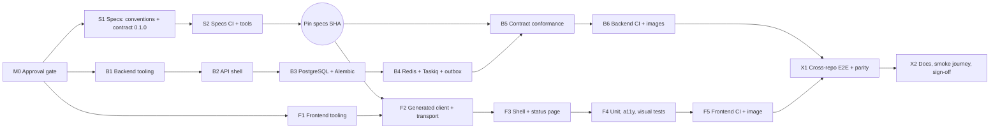
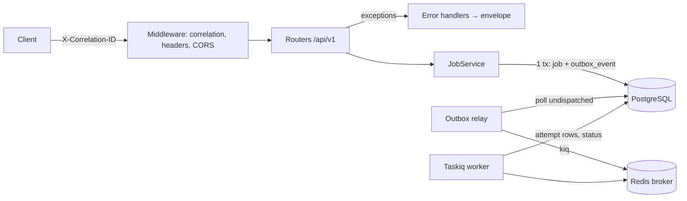

# ATLAS-001 — Engineering Foundation: Implementation Plan

**Status:** Draft — awaiting approval · **Date:** 24 October 2026 · **Implements:** `spec.md` v0.1 · **Tasks:** `tasks.md` · **Verification:** `acceptance.md`

## 1. Approach

Build a **walking skeleton** across the three repositories, in contract order:

1. **Specs first.** Publish conventions, the 0.1.0 contract and specs CI, then cut the `specs.lock` SHA everything else pins.
2. **Backend second.** Tooling → app shell → persistence/migrations → jobs → conformance → CI. It produces a running API that matches the pinned contract.
3. **Frontend third.** Tooling → generated client → status page → tests → CI. Frontend tooling can start in parallel with backend milestone B2. Only the client and status page wait for the pinned contract.
4. **Cross-repo last.** E2E against a real backend, `specs.lock` parity, provenance end to end, README smoke journey.

Each task in `tasks.md` is one small change (≈ 1–4 hours) with a single verification command or observable check. A reviewer can merge it on its own. Tasks never depend on unmerged work in another repository except through a pinned `specs.lock` SHA.

## 2. Milestones and sequencing



| Milestone | Repo | Outcome | Est. effort* |
|---|---|---|---|
| M0 | all | Gate items in spec §11 recorded; register updated; ADR-0006 written | 0.5–1 day (decision time) |
| S1 | specs | `conventions.md`, `compatibility.md`, error/build-info/job schemas + examples, `atlas-api.yaml` 0.1.0 | 1.5 days |
| S2 | specs | `tools/` validators, specs CI workflow, first tag `contract-v0.1.0` | 1.5 days |
| B1 | backend | uv project, layout, Ruff/mypy/pytest, Makefile, compose | 1.5 days |
| B2 | backend | Settings, app factory, logging, correlation ID, error envelope, health, diagnostics, CORS/headers | 2 days |
| B3 | backend | SQLAlchemy/psycopg, Alembic, ID factory, first migration, migration tests | 1.5 days |
| B4 | backend | Taskiq broker/worker, job service, outbox + relay, retries, ping job, Redis-loss test | 2.5 days |
| B5 | backend | `specs.lock`, OpenAPI export, conformance check | 1 day |
| B6 | backend | CI workflow, audits, Dockerfile api/worker, coverage gate | 1.5 days |
| F1 | frontend | Next.js + pnpm + TS strict + ESLint + Tailwind + tokens + layout | 1.5 days |
| F2 | frontend | `specs.lock`, `gen:api`, transport, env validation | 1.5 days |
| F3 | frontend | `/` and `/status`, states, CSP/security headers | 1.5 days |
| F4 | frontend | Vitest, Playwright (Chromium + WebKit), axe, visual baselines | 1.5 days |
| F5 | frontend | CI workflow, reproducibility check, audit, Dockerfile | 1 day |
| X1 | all | E2E job in frontend CI against backend at a declared ref, lock parity | 1.5 days |
| X2 | all | READMEs, smoke journey run on clean machines, acceptance sign-off | 1 day |

\*Directional, single engineer per track. With one backend and one frontend engineer working in parallel after S2, the expected calendar time is **≈ 2.5–3.5 weeks**.

## 3. Target repository contents after ATLAS-001

### 3.1 `atlas-specs` (additions)

```text
contracts/
  conventions.md
  compatibility.md
  openapi/atlas-api.yaml            # 0.1.0
  schemas/error.v1.json  build-info.v1.json  job.v1.json
  examples/{error,build-info,job}/{valid,invalid}-*.json
tools/
  check_specs_lock.py               # validates a consumer's specs.lock against this repo
  check_registry.py                 # RTM: unique IDs, backlog/decision references exist
  requirements.txt | pyproject      # pinned tool deps (tooling only, not product code)
.markdownlint-cli2.yaml  redocly.yaml
Makefile                            # `make check` runs every CI step locally
.github/workflows/specs-ci.yml
adr/ADR-0006-three-repository-contract-governance.md
features/ATLAS-001-engineering-foundation/{spec,plan,tasks,acceptance}.md
```

### 3.2 `atlas-backend`

```text
pyproject.toml  uv.lock  .python-version  .env.example  specs.lock  Makefile  compose.yaml  Dockerfile
src/atlas/
  __init__.py  main.py  version.py
  api/routers/{health,diagnostics,jobs}.py  api/dependencies/  api/schemas/{common,build,job}.py
  core/{settings,logging,correlation,errors,ids,security_headers}.py
  domain/__init__.py  modules/<10 empty packages>  connectors/__init__.py
  persistence/{db,models,base}.py  persistence/repositories/jobs.py  persistence/outbox.py
  workers/{broker,tasks,relay,retry}.py
alembic.ini  alembic/env.py  alembic/versions/0001_infrastructure.py
scripts/{export_openapi.py,check_contract.sh}
tests/unit/  tests/integration/  tests/contract/  tests/security/  tests/performance/.gitkeep
.github/workflows/backend-ci.yml
```

### 3.3 `atlas-frontend`

```text
package.json  pnpm-lock.yaml  .nvmrc  tsconfig.json  next.config.ts  eslint.config.mjs  .env.example  specs.lock  Dockerfile
src/app/{layout.tsx,page.tsx,status/page.tsx,globals.css}
src/components/{ui,canvas,shell}/.gitkeep  src/features/{studio,explore,intelligence}/.gitkeep
src/generated/api/schema.d.ts       # generated, committed, header "do not edit"
src/lib/api/{transport.ts,errors.ts,correlation.ts}  src/lib/env.ts
src/styles/tokens.css
scripts/{gen-api.mjs,check-specs-lock.mjs}
tests/unit/  e2e/{status.spec.ts,a11y.spec.ts,visual.spec.ts}  e2e/__screenshots__/
playwright.config.ts  vitest.config.ts
.github/workflows/frontend-ci.yml
```

## 4. Key designs

### 4.1 Contract pipeline

```mermaid
sequenceDiagram
  participant S as atlas-specs
  participant B as atlas-backend CI
  participant F as atlas-frontend CI
  S->>S: PR edits atlas-api.yaml (+examples); CI: lint, examples, oasdiff breaking vs last tag
  S->>S: merge + tag contract-vX.Y.Z (SHA = S1)
  B->>B: PR bumps specs.lock → S1
  B->>S: checkout at S1 (read-only token)
  B->>B: export FastAPI OpenAPI → oasdiff vs S1 contract (both directions) → must be empty
  F->>F: PR bumps specs.lock → S1
  F->>S: checkout at S1
  F->>F: gen:api → git diff --exit-code (reproducible) → tsc
  F->>B: E2E: start backend at declared ref; assert backend specs_sha == S1
```

- **Rollout rule (compatibility.md):** additive change → backend bumps first, then frontend. Breaking change → new major path or parallel version. It never ships unpaired.
- **Lock parity:** the frontend E2E job fails if `GET /diagnostics/build.specs_sha` ≠ the frontend `specs.lock`. This catches a frontend built against a different contract than the backend under test.

### 4.2 Backend runtime



- **App factory** `create_app(settings)` makes tests construct isolated apps. `/docs` and `/openapi.json` are served only in `local`/`dev`.
- **Correlation ID** format: `req_` + 26-char ULID/UUIDv7 text. Inbound IDs that don't match `^[A-Za-z0-9_-]{8,64}$` are replaced.
- **Error handling** has one exception hierarchy `AtlasError(code, http_status, message, recoverable, details)` and handlers for `AtlasError`, `RequestValidationError`, `StarletteHTTPException` and `Exception`.
- **Readiness** runs `SELECT 1` with a timeout and Redis `PING` with a timeout. The probe has a budget of ≤ 1 s each.
- **Jobs**
  - Creation is idempotent: `INSERT … ON CONFLICT (type, idempotency_key) DO NOTHING RETURNING`, falling back to a select.
  - The relay polls `outbox_event WHERE dispatched_at IS NULL ORDER BY created_at LIMIT n FOR UPDATE SKIP LOCKED`, dispatches, then marks it dispatched. Delivery is at-least-once, so the worker is idempotent. A `succeeded` job is a no-op on redelivery.
  - Retry uses exponential backoff with full jitter (`base * 2^n`, capped), configured by `ATLAS_JOB_MAX_ATTEMPTS`, `ATLAS_JOB_BACKOFF_BASE_S` and `ATLAS_JOB_BACKOFF_MAX_S`. It is implemented as Taskiq middleware or an explicit re-kiq with delay. The chosen mechanism is verified by an integration test, not assumed from library defaults.
- **Process model:** `make worker` runs the Taskiq worker and the relay loop as separate processes from the same codebase. Production would deploy them as separate containers built from the `worker` target.

### 4.3 Migrations discipline

- Alembic uses `target_metadata = Base.metadata` and a constraint naming convention (`pk_%(table_name)s`, `fk_…`, `uq_…`, `ix_…`, `ck_…`).
- Migration file names: `NNNN_<slug>.py`, sequential and human-reviewed. Autogenerate is a starting point and is always edited.
- Policy (documented in the backend README):
  - expand/migrate/contract for breaking changes;
  - no data migrations inside schema migrations without review;
  - downgrade is required;
  - long-running index builds use `CONCURRENTLY` in their own migration.
- CI checks:
  - `upgrade head`, `downgrade base`, `upgrade head` on an empty database;
  - `alembic check` (no pending autogenerate diff);
  - single head.

### 4.4 Frontend runtime

- `src/lib/env.ts` validates `NEXT_PUBLIC_ATLAS_API_BASE_URL` (URL) and `NEXT_PUBLIC_ATLAS_FRONTEND_SHA` (build-time). It fails fast at build and dev start.
- `src/lib/api/transport.ts` creates the openapi-fetch client with `baseUrl` and adds `X-Correlation-ID`. Every non-2xx response maps to `AtlasApiError {code, message, correlationId, recoverable, status}`. A network failure maps to `code: "NETWORK_UNAVAILABLE"`, which is a client-side code and is documented as such.
- `/status` is a client component using TanStack Query. TanStack Query is added here because Tech §5.1 makes it the server-state standard. It has distinct `loading`, `ready`, `degraded` (ready = 503) and `unreachable` states, plus a retry button that actually refetches.
- `/` is server-rendered, uses tokens and contains one link. There is no navigation rail yet, because empty navigation would be a dead control.
- Security headers are set in `next.config.ts` `headers()` for production. Dev mode relaxes CSP only as far as Next.js dev requires, and E2E runs against `next build && next start`.

### 4.5 CI pipelines

| Repo | Jobs (in order) | Services | Gate |
|---|---|---|---|
| specs | `docs-lint` → `contract-lint` → `schema-examples` → `breaking-change` (vs last `contract-v*` tag) → `registry-check` | – | All required |
| backend | `lock-and-sync` (uv `--locked`, `specs.lock` validation) → `static` (ruff check, ruff format --check, mypy) → `unit` → `integration` (+ migrations) → `contract` (checkout specs@SHA, oasdiff) → `security` (pip-audit, secret scan) → `images` (build api + worker) | postgres:16, redis:7 | All required; coverage ≥ 85% |
| frontend | `install` (frozen) → `static` (tsc, eslint) → `unit` (vitest, coverage) → `client-repro` (checkout specs@SHA, gen:api, `git diff --exit-code`) → `build` (next build) → `security` (pnpm audit, secret scan) → `e2e` (backend@ref + postgres + redis; Chromium + WebKit; axe; visual) → `image` | postgres:16, redis:7 (for E2E) | All required |

- **Backend ref for frontend E2E:** `e2e/backend.ref` (a file containing a backend commit SHA, bumped deliberately) or the workflow input `backend_ref`. Default is the SHA in the file, never a floating branch for release builds. This mirrors the specs rule.
- **Secrets:** `ATLAS_SPECS_READ_TOKEN` (and `ATLAS_BACKEND_READ_TOKEN` in the frontend) are read-only, per FD-07. No other secrets are needed in ATLAS-001.
- **Caching:** uv cache and pnpm store cache keyed by lockfile hash. Playwright browsers are cached by version.

## 5. Test strategy

### 5.1 Pyramid for the foundation

| Layer | Backend | Frontend | Specs |
|---|---|---|---|
| Static | Ruff (incl. `S`, `B`, `UP`, `I`), mypy strict | tsc strict, ESLint (next + typescript-eslint strict) | markdownlint, Redocly lint |
| Unit | settings validation; correlation ID accept/replace; error envelope mapping (HTTP/validation/unhandled); redaction filter; ID factory monotonicity; backoff calculation; build-info assembly | env validation; transport error mapping (envelope, non-JSON, network); status state reducer | – |
| Property-based | Hypothesis: backoff never exceeds cap and is non-negative; correlation ID sanitizer never echoes invalid input | – | – |
| Integration (real PostgreSQL/Redis) | migrations round-trip + `alembic check`; job create is atomic with outbox (rollback test); duplicate idempotency key; worker success/failure/retry/exhaustion; relay re-dispatch after Redis flush; readiness 200/503 (Redis stopped) | – | – |
| Contract | FastAPI OpenAPI ≡ pinned contract (oasdiff); responses validated against `contracts/schemas` in API tests | generated client reproducible; compiles; transport typed against generated paths | examples validate (valid pass, invalid fail); no breaking change without major bump |
| Security baseline | 500 envelope has no traceback/SQL/hostnames; diagnostics 404 when disabled and refused at startup in uat/prod; CORS rejects unlisted origin; security headers present; secrets redacted in logs | CSP/security headers present on `next start`; no secrets in client bundle (`NEXT_PUBLIC_` audit) | secret scan |
| E2E (real browser, persisted backend) | – | `/status` shows live data and SHAs; degraded state when Redis is stopped; lock parity; keyboard navigation | – |
| Accessibility | – | axe-core on `/` and `/status` (0 serious/critical) | – |
| Visual | – | golden screenshots 1440×900, 1280×720 (CI container only) | – |

### 5.2 Test data and isolation

- Backend integration tests use a dedicated database per test session (`atlas_test_<worker>`), with transactions rolled back per test where possible. Migration tests use a fresh empty database.
- There are no shared mutable fixtures across repos. Golden datasets arrive with BL-016.
- E2E clears job tables between runs via a test-only CLI command (`python -m atlas.scripts.reset_test_db`), which refuses to run unless `ATLAS_ENV=test`.

### 5.3 Definition of done (per task)

1. The task's verification step passes locally and in CI.
2. Static checks and the coverage threshold hold.
3. No new warnings.
4. README or docs updated if a command or variable changed.
5. The PR references the task ID (`A001-T-nnn`) and the acceptance criterion it advances.

## 6. Risks and mitigations

| ID | Risk | Mitigation | Owner |
|---|---|---|---|
| R-01 | FastAPI-generated OpenAPI differs cosmetically from the hand-authored contract, so conformance is noisy | Author the 0.1.0 contract from the intended Pydantic shapes, compare with oasdiff structural diff (FD-08), and keep descriptions out of the comparison. If friction persists, revisit (code-first export proposed back to specs) via ADR | Backend lead |
| R-02 | Taskiq retry/ack semantics differ from expectations in the pinned version | Durable state lives in PostgreSQL (truth), and integration tests assert behaviour. The retry mechanism is chosen in T-B4-x after a short check | Backend lead |
| R-03 | Cross-repo checkout needs credentials not yet approved | FD-07 gate item. Until then, CI uses a manually triggered job and the local sibling clone | Release coordinator |
| R-04 | Visual baselines flap across OS/fonts | Generate and compare only in a pinned Playwright container image. Developers run visual tests only via the container | Frontend lead |
| R-05 | Local container runtime not permitted on corporate laptops | FD-05 alternatives: native PostgreSQL/Redis with the same env vars. README covers both | Platform |
| R-06 | Diagnostics endpoints accidentally enabled in shared environments | Startup refuses `ATLAS_DIAGNOSTICS_ENABLED=true` when `ATLAS_ENV ∈ {uat, prod}`, with a test | Backend lead |
| R-07 | Foundation scope creep into domain or auth | Non-goals in spec §3. Reviewers reject domain tables and auth code in ATLAS-001 PRs | Both leads |
| R-08 | Library versions in this plan go stale | FD-11 pin-at-implementation policy. The plan names tools, not exact versions | Both leads |

## 7. Rollout

- Every change lands as a normal reviewed Git pull request in its own repository. This is development workflow, not an Atlas product feature.
- Merge order is S1 → S2 (tag) → B1…B6 and F1…F5 in parallel → X1 → X2.
- After X2:
  - tag `atlas-backend` `v0.1.0`, `atlas-frontend` `v0.1.0` and `atlas-specs` `contract-v0.1.0`;
  - record the triple in the release notes of each repo;
  - update the decision register, setting confirmed FD-xx/DEC rows to Confirmed with ADR links.
