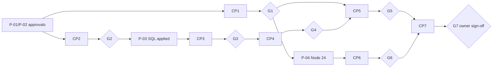
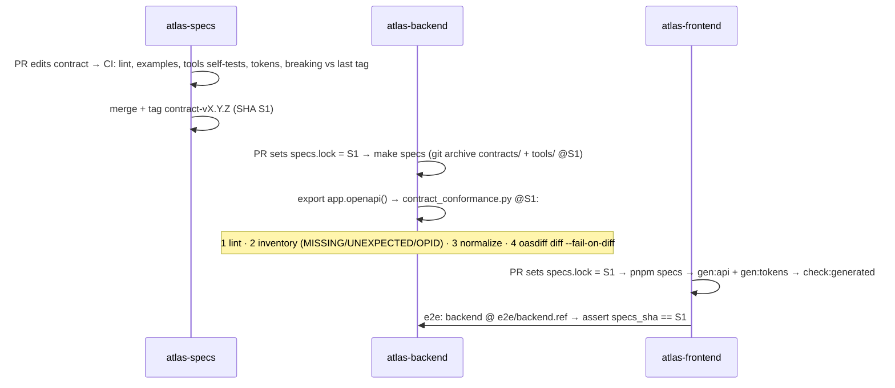

# ATLAS-001 — Engineering Foundation: Implementation Plan

**Version:** 0.2.1 (final candidate) · **Date:** 24 October 2026 · **Status:** Approved for Implementation (owner, 24 Oct 2026); CP1 authorized; ATLAS-001 not Accepted until G7 · **Implements:** `spec.md` v0.2.1 · **Tasks:** `tasks.md` v0.2.1 · **Verification:** `acceptance.md` v0.2.1 · **Readiness:** `readiness.md`

## 1. Approach

A walking skeleton, built contract-first, in seven checkpoints. Each checkpoint touches **one repository** and ends with a gate. The gate's acceptance criteria must pass before dependent work starts.

| CP | Repository | Outcome | Gate | Tasks | Est.* |
|---|---|---|---|---|---|
| CP1 | atlas-specs | Conventions, contract 0.1.0, tokens, tools (lock, conformance, tokens, registry), lint via pinned containers, CI, release tag | G1 | 12 | 2.5 d |
| CP2 | atlas-backend | uv project, quality gates, settings with guards, logging, correlation, errors, app factory, diagnostics, doctor | G2 | 8 | 2 d |
| CP3 | atlas-backend | Engine, readiness (DB), Alembic baseline, migration and least-privilege tests | G3 | 4 | 1 d |
| CP4 | atlas-backend | Redis factory and broker, ping task, worker round trip, safety check, smoke | G4 | 5 | 1.5 d |
| CP5 | atlas-backend | specs.lock, conformance, contract tests, images, bootstrap SQL, CI, README | G5 | 8 | 2 d |
| CP6 | atlas-frontend | Next.js + Node 24, env, generated client and tokens, transport, layout, `/`, `/status`, CSP, image | G6 | 9 | 2.5 d |
| CP7 | frontend (+ one release task each in backend and specs) | Chromium E2E, CI, persisted-backend E2E, README, tags, evidence | G7 | 7 | 1.5 d |

\*Directional, one engineer per track. CP6 runs in parallel with CP2–CP5 after G1, so two engineers need about **1.5–2 calendar weeks**.



## 2. Shared-service safety model (DEC-043/044/045)

The owner's PostgreSQL 15.12 and Redis 7.4.9 are shared with other projects. Engineering rules:

1. **Only owner-approved Atlas objects.** No Atlas command or test creates, alters or drops anything outside `atlas_db`, `atlas_test` and the four `atlas_*` roles, and those exist only once the owner has applied the reviewed SQL (P-03). Atlas never modifies other projects' databases, even to close the `PUBLIC` `CONNECT` exposure. That is addressed only by the optional, owner-decided `proposals/pg_hba-atlas.conf`.
2. **Read-only by default.** `make doctor` uses only `SELECT`, `PING`, `INFO`, `SCAN` and `DBSIZE`. Snapshots are for before/after evidence.
3. **Failure simulation without disruption.** Dependency-failure tests point a URL at a closed local port. They never stop or reconfigure a shared service.
4. **Redis key hygiene.** DB 10 (local) and 11 (test) only, enforced by the client factory.
   - Every Atlas key carries a prefix (`atlas:local:`, `atlas:test:<run_id>:`).
   - Tests register each key they create and `UNLINK` exactly those keys.
   - A session guard fails the run if anything under the run prefix remains, or if the set of other keys in DB 11 changed.
   - `FLUSHALL`, `FLUSHDB`, pattern deletes, `CONFIG SET`, `SWAPDB` and `SELECT` are banned by a static test.
5. **Library keys.** Taskiq's queue key is configurable (`queue_name`) and set under the prefix. If B-13/B-15 find any library key that cannot be prefixed, it is tracked and deleted by exact name, and the finding is recorded in `evidence.md`. If that turns out to be impossible, the checkpoint stops and the issue goes back to the owner rather than being worked around.
6. **CI isolation and stronger auth.** Every CI job gets its own `postgres:15` (with `scram-sha-256` for all connections) and `redis:7.4` service containers. They are bootstrapped with the same role/DB/index model and random per-run passwords, so CI exercises the same isolation rules plus real password authentication (FR-39).

## 3. Key designs

### 3.1 Contract pipeline and conformance



FastAPI-side rules that make step 4 achievable (from the review-01 probe, FastAPI 0.162 / Pydantic 2.14):

- Explicit `operation_id` on every route, matching the contract names.
- The envelope declared for 4xx/5xx through router-level `responses`, so FastAPI's automatic `HTTPValidationError` does not appear. Probe: a route declaring 422 no longer gets the automatic schema. B-06 confirms the router-level variant with a test asserting the component is absent.
- An `openapi()` hook that adds the `X-Correlation-ID` header reference to every response. FastAPI does not emit response headers from middleware.
- The contract is written in the Pydantic dialect: optional fields as `anyOf [... , {type: null}]` (style guide). The normalizer canonicalizes both forms anyway.
- The schema is environment-invariant: diagnostics routes are always registered and guarded at runtime.

### 3.2 Backend runtime (ATLAS-001 scope)

```mermaid
flowchart LR
  C[Browser / curl] -->|X-Correlation-ID| MW[correlation · security headers · CORS]
  MW --> R["/api/v1 routers (explicit operation_id)"]
  R --> EH[error handlers → envelope]
  R -->|runtime role atlas_app| PG[(atlas_db · schema atlas)]
  R -->|DB 10 · atlas:local:| RD[(Redis)]
  W[Taskiq worker] -->|queue atlas:local:taskiq:queue| RD
  AL[Alembic] -->|atlas_migrator (owner of schema atlas)| PG
```

There are no job tables and no outbox. Durable job state, at-least-once delivery, retries and Redis-loss recovery are BL-201's job (DEC-046) and a **hard prerequisite** for the first business background job.

### 3.3 Frontend foundation

- Generated, never hand-written:
  - `src/generated/api/schema.d.ts` from the contract;
  - `src/styles/tokens.generated.css` and the Tailwind theme mapping from `design/tokens.json`.
  Both come from the pinned SHA, and `check:generated` enforces reproducibility.
- `src/lib/api/transport.ts` is the only API boundary, so a later BFF (DEC-027) replaces one module.
- Global styles:
  - `color-scheme: light`;
  - the focus ring;
  - a typography base;
  - a reduced-motion block that sets transition and animation durations to `0.01ms` and removes transforms.
- Pages:
  - `/` is a labelled placeholder with one link;
  - `/status` is a diagnostics view with six explicit states.
- Deliberately absent: navigation rail, Home, component library, icons.

### 3.4 CI

| Repo | Jobs | Notes |
|---|---|---|
| specs | `docs-lint` (non-baseline docs), `contract`, `tools`, `tokens`, `registry`, `breaking` | oasdiff image pinned by digest |
| backend | `static`, `unit`, `integration` (pg15 + redis7.4 services, bootstrap SQL), `contract` (specs @ lock SHA), `security`, `images` | Coverage ≥ 85% |
| frontend | `static`, `unit`, `generated` (specs @ lock SHA), `build`, `security`, `image`, `e2e` (backend @ ref + services, Chromium) | Node from `.nvmrc` (24) |

Access model and hardening: `ci-access.md`. Mode A (public repos) needs no secrets. Mode B (GitHub App installation tokens) is ready if the repos go private. No PATs.

## 4. Test strategy

| Layer | Backend | Frontend | Specs |
|---|---|---|---|
| Static | Ruff (`S`,`B`,`UP`,`I`), mypy strict | tsc strict, ESLint `--max-warnings 0` | markdownlint (non-baseline), Redocly |
| Unit | settings guards, logging redaction, correlation, error mapping, app conventions, diagnostics, ping task body, Redis safety | env, transport/errors, generated tokens CSS, layout, `/`, `/status` states | tools self-tests (lock, conformance ×7, tokens, registry) |
| Integration (real services, Atlas-isolated) | readiness (DB, Redis), migrations round trip, least privilege, worker round trip with key hygiene | – | – |
| Contract | conformance (inventory + exact diff), response bodies vs JSON Schemas | client/tokens reproducibility | examples valid/invalid; breaking vs previous tag |
| E2E (Chromium, persisted backend) | – | status journey, keyboard-only, reduced motion, axe, lock parity | – |
| Deferred | durable jobs, outbox (BL-201) | screenshot baselines, WebKit (DEC-055) | – |

Integration tests run serially against `atlas_test` (a small suite), so no `CREATE DATABASE` is needed. Coverage thresholds apply from the first code task.

## 5. Decisions in this plan

| Status | Items |
|---|---|
| Approved | DEC-043 PG 15 local/CI · DEC-044 PG isolation + separate credentials (SQL pending P-03) · DEC-045 Redis isolation · DEC-046 defer outbox/durable jobs · DEC-047 GitHub Actions, no PATs · DEC-048 Node 24 LTS · **D-07:** DEC-020 (Python 3.12, pinned compatible deps), DEC-024, DEC-028, DEC-038 (incl. mypy, openapi-typescript), DEC-039 (immutable-SHA pinning; tags only for approved releases), DEC-040 (layout; Tech §17.3 deviation recorded) |
| Pending owner | Explicit approval of the final spec set; DEC-085 visibility (security decision) |
| Provisional (Claude-resolved, reversible) | DEC-090…099 (spec §3.3) |
| Unresolved, not blocking | DEC-055, DEC-065, DEC-083, DEC-084, DEC-086 |

## 6. Risks

| ID | Risk | Mitigation |
|---|---|---|
| R-01 | Normalizer misses a cosmetic FastAPI/Pydantic variation, so conformance is noisy | 7 self-test fixtures, including a Pydantic-generated case. New variations become fixtures. The tool versions with the contract |
| R-02 | taskiq-redis writes a key outside the prefix | Key tracker plus session guard detect it. Stop-and-escalate rule (§2.5) |
| R-03 | `trust` auth hides credential mix-ups locally, and Atlas roles can reach other `PUBLIC`-connectable databases | Settings guards (FR-21), doctor warning (FR-35), CI scram enforcement and `ci_auth` test (FR-39), optional `pg_hba-atlas.conf` (DEC-084) |
| R-04 | Owner's shared services change state (container restart, DB 1 data) | Read-only doctor detects unreachable services. Atlas never depends on non-Atlas state |
| R-05 | Node 24 not yet installed | P-04 precondition. CP6 does not start without it |
| R-06 | Repositories are public; future contracts and decisions describe the organisation's architecture model | DEC-085 security decision, recommendation private (spec §6.8). Specs never contain real architecture data or secrets |
| R-07 | Scope creep into domain/auth/UI | Spec §2 and AC-17 scope guard |
| R-08 | Library versions drift | Lockfiles. Image digests pinned. Actions pinned by SHA |

## 7. Rollout

- Normal reviewed pull requests per repository. This is the development workflow, not an Atlas product feature.
- Merge order follows the checkpoints.
- After G7: tags `contract-v0.1.0` / `v0.1.0` / `v0.1.0`, the SHA triple in `evidence.md`, and the owner's signature. Then the register is updated by owner instruction.
