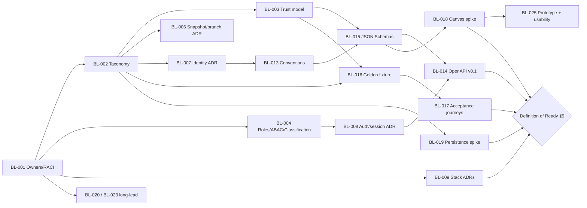

# ATLAS — Phase 0 Engineering Blueprint & Specification Readiness Assessment

**Version:** 0.1 · **Date:** 24 October 2026 · **Status:** Proposed for review. This document does not approve scope or decisions.  
**Assessed baselines:** `brd/Atlas_Enterprise_Architecture_BRD_v2_2.md` (BRD), `ux/Atlas_Bright_UX_Interaction_Requirements_v1_1.md` (UX), `technical/Atlas_Technical_Architecture_System_Design_v1_1.md` (Tech).  
**Companion artifacts (this release):**

| Artifact | Purpose |
|---|---|
| `phase0/requirement-traceability-matrix.md` | Human-readable RTM: 393 requirements → phase, backlog, module, API/data, decisions, readiness |
| `phase0/requirements-registry.csv` | Same RTM, machine-readable (full requirement text). Intended ID authority (DEC-082) |
| `phase0/prioritized-backlog.md` | 85 ranked backlog items, Phase 0 – Phase 5 |
| `decisions/decision-register.md` | 68 decisions: **12 Confirmed · 22 Proposed · 34 Open** |

**Boundary of this work:** specification-only. `atlas-backend` and `atlas-frontend` were not modified and no production code was written. Spikes listed in the backlog (BL-018, BL-019, BL-025) are future throwaway work on non-`main` branches.

---

## 1. Executive summary

**Verdict: the specifications are ready to start Phase 0 and not ready for production code.**

The three baselines agree on product intent and on the hard rules: graph/layout separation, evidence and trust, authorization before computation, bounded projections, deterministic governance, and the PR/telemetry exclusions. That agreement is strong, and those rules are recorded as **Confirmed** (register §A). What is missing is the *engineering-grade definition* needed to write code against:

| Readiness dimension | Finding | Evidence |
|---|---|---|
| Contracts | **Not started.** `contracts/openapi` and `contracts/schemas` are empty; Tech §6.1 sketches 24 endpoints at path level only | 250 of 393 requirements need an endpoint not in Tech §6.1 (RTM `API` gap) |
| Canonical vocabulary | **Conflicting.** Relationship types, roles, trust/verification states differ between BRD and Tech | DEC-050, DEC-051, DEC-056; together they block 82 requirement mappings |
| Testable acceptance | **Partial.** BRD §5.1–5.17 (111 IDs) use one generic boilerplate acceptance sentence; UX gives testable criteria for some | 79 requirements still have no specific criterion (RTM `AC` gap) |
| Decision ownership | **Absent.** BRD: decision owners "to be nominated" | DEC-081 blocks every sign-off |
| Planning model | **Inconsistent.** Four phase schemes; Must ≠ MVP | DEC-052, DEC-053 |
| Non-functional targets | **Inconsistent** datasets and percentiles; no reference hardware | DEC-054, DEC-055 |
| Data model coverage | Tables missing for stories, comments, notifications, preferences, cost | 34 requirements (RTM `DATA` gap) |

**RTM readiness today:** R0 Blocked = 177, R1 Gaps = 137, R2 Contract-ready = 79, R3 Contract-approved = 0. Of the **179 Phase 1 requirements**, 96 are blocked by an open decision. Closing **nine decisions** unblocks 74 of those 96: DEC-050, 051, 054, 055, 056, 058, 062, 063, 027. The remaining 22 also depend on narrower decisions (zoom budgets, layout precedence, sharing, icons, export, classification, retention, analytics, capability-map phasing) that should close inside Phase 0 or early Phase 1.

**Recommendation:** run a 3–4 week Phase 0 (blueprint §8.1) with three parallel tracks: **Decisions** (close the nine above plus sponsor/RACI), **Contracts** (taxonomy → schemas → OpenAPI v0.1 for the vertical slice → golden fixture), and **Spikes** (canvas + persistence benchmarks). Production code starts only when the Definition of Ready in §9 is met.

---

## 2. What is settled (confirmed baseline)

Classification rule (register "How to read"): **Confirmed** = mandatory and consistent across all applicable baselines, or already realized. **Proposed** = one recommendation, explicitly pending validation. **Open** = conflicting, missing or needs external input. Because the baselines describe themselves as *proposed* and decision owners are not yet named, "Confirmed" means confirmed by the finalized documents. It does not mean signed off by a sponsor.

| Confirmed (build on these) | Proposed (prototype against; do not treat as approved) |
|---|---|
| DEC-001 Three independent repositories (realized) | DEC-020 Python 3.12+/FastAPI/Pydantic v2/SQLAlchemy 2/Alembic |
| DEC-002 PR, telemetry, provisioning, autonomous-AI, CMDB-replacement exclusions | DEC-021/022 PostgreSQL 16+ canonical store; CTE traversal; graph DB only if benchmarks fail |
| DEC-003 Atlas self-diagnostics allowed | DEC-023 XYFlow + ELK.js (worker); WebGL optional |
| DEC-004 Azure-first, technology-neutral model | DEC-024 Next.js App Router + TS strict + Tailwind + shadcn/ui + TanStack Query + Zustand |
| DEC-005 Canonical graph separate from presentation/layout | DEC-025/034 Identity & per-field source precedence |
| DEC-006 Provenance/trust; unknown ≠ negative; no auto-merge by name | DEC-026 Entra OIDC + RBAC/ABAC |
| DEC-007 Authorize before traversal/search/count/AI/export | DEC-028/029 Taskiq+Redis+PG outbox; PG FTS/trigram |
| DEC-008 Deterministic rules, five statuses | DEC-030 Azure Container Apps (pilot) |
| DEC-009 Proposals never mutate published facts without approval | DEC-031 MVCC/revision manifest + branch patches |
| DEC-010 Read-only, least-privilege discovery | DEC-032/033/035/036/037 Import formats, AI adapter, anti-enumeration, rule DSL, UUIDv7 |
| DEC-011 Bright/light flagship theme (palette proposed) | DEC-038/039/040 Tooling, contract-first workflow, specs folder layout |
| DEC-012 Real-browser, persisted-state acceptance; no dead controls | DEC-041/042 Desktop-first; contract-mock FE development |

---

## 3. Missing or conflicting requirements

### 3.1 Conflicts between baselines

| ID | Severity | Conflict | Where | Impact if unresolved | Resolution path |
|---|---|---|---|---|---|
| CF-01 | **Critical** | Two different relationship-type vocabularies. BRD-only types: `CALLS_API`, `READS`, `WRITES`, `DEPENDS_ON`, `PROTECTS`, `HOSTED_IN`, `DEPLOYED_ON`. Tech-only types: `CONTAINS`, `SUPPORTS_CAPABILITY`, `EXPOSES_API`, `STORES_IN`, `CONNECTS_TO`, `DECIDED_BY`. DDL references `REFERENCES_SELF`, which appears in neither list | BRD INV-02 vs Tech §3.3, §3.5 | Schema, taxonomy validation, projections, imports, rules and AI all encode the wrong set | DEC-050 → BL-002 |
| CF-02 | **Critical** | Three role lists: BRD GOV-01 (7 roles), BRD E17 (8), Tech §9.1 (8, different names). The Tech §9.2 matrix needs security approval; E17 forbids development before an approved matrix | BRD §5.6, E17; Tech §9 | Authorization model, UI role-aware controls and negative tests cannot be written | DEC-051 → BL-004 |
| CF-03 | **High** | Trust/evidence/verification vocabularies differ (7 tech trust states; DEP-04 evidence types; E06 and PASS-07 completeness states; UX "Verified" badge) | Tech §3.4; BRD DEP-04, E03, E06, PASS-07; UX §6.1 | Inconsistent legends, misleading certainty, untestable "never conflated" rules | DEC-056 → BL-003 |
| CF-04 | **High** | Four phasing schemes place features differently (e.g. Rule Engine: Tech P3, BRD E19 R3, BRD §12 P4; Patterns: BRD §12 P3, E19 R4, UX R2; curated capability maps: BRD §12 P1 vs Tech P1 "sample", P4 "advanced") | BRD §12, E19; UX §14; Tech §18 | Scope disputes at every gate | DEC-052; mapping in §8.4 |
| CF-05 | **High** | NFR targets differ: canvas p75 ≤2 s (BRD E14/§8) vs p95 ≤3 s (UX-NFR-003, Tech §20.2); pilot 10k/100k (BRD) vs 10k/40k (Tech §4.4); design scale 100k/1m (BRD) vs 100k/500k and 1m/10m (Tech); 45–60 FPS vs "perceptually smooth" | BRD §8, E14; UX §11; Tech §4.4, §20.2 | Benchmarks pass one document and fail another | DEC-054 → BL-010 |
| CF-06 | Medium | Priority semantics: Must/Should/Could mixed with P0/P1/P2. "Must" items appear in Phase 3–4 | BRD §5, §5.23 | "Must" is read as MVP and scope inflates | DEC-053 |
| CF-07 | Medium | Browser support: Chrome/Edge/Safari (BRD §8) vs "Chromium + one additional" (UX-NFR-011) | BRD §8; UX §11 | Test matrix ambiguity | DEC-055 |
| CF-08 | Medium | Passport mandatory fields defined twice and differently | BRD E16 vs UX §6.2; UX-OD-06 | Passport DTO and completeness score disagree | DEC-062 |
| CF-09 | Medium | **Appendix A "Relationship inspector" lists "traffic"**, and BRD §3 promises "Navigate Azure hierarchy with *live* context". Both contradict the telemetry exclusion | BRD App A, §3 vs E20 | Accidental scope creep into telemetry | Re-word in BRD v2.3: "configured protocol" and "fresh configuration context" (BL-012) |
| CF-10 | Medium | J03 "Production incident" journey and §11 "CMDB/ITSM: incidents, changes" vs E20 exclusion of "incident event correlation" | BRD §6 J03, §11, E20 | Ambiguous ITSM scope | DEC-079 |
| CF-11 | Medium | CON-04 (Must) requires ingesting repositories/IaC/specs from source control; Tech §7.1 has no source-control connector, and the PR exclusion needs a boundary | BRD CON-04, §11; Tech §7.1, §1 | Must requirement with no design | DEC-078 → BL-212 |
| CF-12 | Medium | CON-05 (Must) messaging topology; Tech §7.1 has no Service Bus/Event Hubs connector row (only generic ARM) | BRD CON-05; Tech §7.1 | Must requirement with no design | BL-207, add row in Tech v1.2 |
| CF-13 | Low | Identifier collisions: BRD requirement family `ADR-01…05` vs Tech `ADR-001…014` vs `ADR-REPO-001` vs folder `ADR-0001`; Tech epics `E01–E09` vs BRD `E01–E20`; BRD has no E15; §5.23 is numbered twice | BRD, Tech §19, §22 | Traceability errors | DEC-082 |
| CF-14 | Low | Stale references: UX header "Companion to BRD V2.0"; BRD App C cites `…UX_Interaction_Requirements_v1.md`; Tech §17.3 folder layout differs from the repo; UX §2.1 Compute violet `#8C58D8` absent from Tech §5.3 | UX header; BRD App C; Tech §5.3, §17.3 | Confusion over which document version is authoritative | BL-012, DEC-040, DEC-065 |
| CF-15 | Low | BRD §5.23–5.36 tables have header `Requirement ID \| Strength \| Functional requirement`, but rows put the requirement text in "Strength" and "Must" in "Functional requirement" | BRD §5.23–5.36 | Mis-parsing by tools; human confusion | BL-012 (registry CSV already normalizes) |

### 3.2 Missing requirements (gaps no baseline covers)

| ID | Gap | Why it matters | Proposed handling |
|---|---|---|---|
| G-01 | **Discovery publication semantics**: does a non-conflicting sync auto-publish, and how do open branches absorb discovery changes? | Determines the snapshot model, branch merge and the meaning of "published" | DEC-057 (with DEC-031), BL-006 |
| G-02 | **Data classification scheme** (levels, field-level scope, default for unclassified) | ABAC, redaction, export markers and AI filtering cannot be built without it | DEC-073 |
| G-03 | **Tenancy model** (single org/multi Azure tenant vs multi-organization) | Changes every table key and policy | DEC-058 |
| G-04 | **Layout reconciliation** when the graph changes under a saved view (new/removed/re-parented nodes) | BRD J04 "layout survives graph refresh" is untestable otherwise | DEC-059 |
| G-05 | **Token/session architecture** (BFF vs SPA bearer); Tech mentions both | XSS blast radius and the CSRF model | DEC-027 |
| G-06 | **Client-side draft retention**: UX-CAN-017 says "network failure retains local draft until retry/export", without saying where it is stored or whether classified content may be kept in browser storage | Possible leak of restricted architecture via local storage | Threat model BL-022; proposal: in-memory plus encrypted session-scoped store, purge on logout, no restricted fields |
| G-07 | **Capability/permission discovery for the UI**: UX-CAN-024/UX-GLB-003 require role-aware controls, but no endpoint tells the frontend what the user may do | FE would duplicate authorization rules (prohibited by Tech §17.2) | Contract C-10 `GET /me` + per-resource `allowed_actions` |
| G-08 | **Deep-link / view-state encoding** (entity, view, lens, filters, focus, viewport, snapshot) | UX-GLB-008 and UX-PASS-001 need a stable URL contract across releases | Schema in BL-015 |
| G-09 | **Error-code catalog** beyond the single `REVISION_CONFLICT` example | FE needs deterministic recovery UX (UX-GLB-006) | BL-013 |
| G-10 | **CSV/manual inventory import format** (BRD CON-08, E19 R1) | Release 1 scope item with no schema | Contract C-17, BL-124 |
| G-11 | **Retention, archival, legal hold, backup/restore objectives** | Audit "immutable archival" and DR are unbounded | DEC-074 |
| G-12 | **Definition of "critical application" / criticality scale** used in success metrics (90% ownership of critical apps) | Metrics are not measurable without it | DEC-062 |
| G-13 | **Product analytics privacy** (BRD §8 feature adoption, §18 task completion, 60% WAU) | Needed to prove success; privacy review needed | DEC-076 |
| G-14 | **Quotas and rate limits** (API 429, AI token/cost quotas, export size limits) are named but not sized | Abuse resistance and cost control | BL-013 conventions + BL-022 |
| G-15 | **Internationalization, time zones, date formats** are not mentioned anywhere | Timestamps (sync time, attestation expiry) are displayed everywhere | Proposal: English UI, UTC storage, user-local display; record as Proposed in the next register revision |
| G-16 | **Story, scene, comment, subscription, preference, favorites/recent tables** absent from Tech §3.5 | 34 RTM `DATA` gaps (CMD, COL, NTF, STORY, FLOW, COST) | Add to Tech v1.2 data model before the owning phase |
| G-17 | **Cost module** absent from the tech design (COST-*, CON-09 billing) | Phase 5 feature with no design | Tech addendum before BL-502 |
| G-18 | **Seed data specification** for the MVP slice (names, hierarchy, owners, conflicts, ACL personas) | Every Phase 1 E2E, visual baseline and demo depends on it | BL-016 |

### 3.3 Acceptance-criteria quality

- BRD §5.1–5.17 (111 IDs) all share one acceptance sentence ("Given authorized representative fixtures… the user can verify: <requirement text>…"). It is not testable.
- 32 of these gain a testable criterion through a UX counterpart (RTM *Notes* column, e.g. CAN-06 → UX-CAN-010). **79 still need specific Given/When/Then**, 17 of them in Phase 1: INV-01/02/03/05/06/07, CAN-11, DEV-05, DEP-01, CON-08, GOV-01/03/04, KNOW-03/04, SELF-02/04.
- Recommendation: write Phase 1 criteria in BL-017. Write later-phase criteria at that phase's readiness gate (BRD App D).

### 3.4 Duplicated requirements to build once

Overlaps that should be implemented as one capability, with all IDs traced to it (RTM column *build with*): DEV-03/KNOW-01 → Passport (PASS-01–04); DEV-07/EXP-01 → CMD-01/02; SAN-01/02/05 → BRN-01/02/04; GOV-05 → HIST-01/02; CAN-12/EXP-04 → STORY + COL; FLOW-01 → STORY-01; AIX-04 → AI-02; SCORE-03 → RULE-04; DEV-06/KNOW-03 → FBK-*; CON-08 → IMP-* + CSV; CON-10 → SDK-*.

---

## 4. Architectural decisions requiring confirmation

The full set is in `decisions/decision-register.md`. These must be closed **before production code** (needed-by P0):

| Order | Decision | Status | Why first | Recommended position |
|---:|---|---|---|---|
| 1 | DEC-081 Sponsor and decision owners | Open | No other decision can be signed off | Name owners per App D sign-off area |
| 2 | DEC-050 Taxonomy and relationship vocabulary | Open | Foundation of schema, projections, imports, rules | Tech §3.3 canonical + BRD aliases + explicit `PROTECTS` / access-mode decision |
| 3 | DEC-056 Trust/evidence/verification/completeness model | Open | Every screen renders it; 29 Phase 1 requirements | Four orthogonal dimensions (register DEC-056) |
| 4 | DEC-051 + DEC-073 Roles, RBAC/ABAC matrix, classification | Open | Authorization precedes traversal (DEC-007) | Tech §9.1 roles; BRD names as aliases; 4-level classification |
| 5 | DEC-058 Tenancy | Open | Table keys | Single org, multi Azure-tenant source scopes |
| 6 | DEC-031 + DEC-057 Snapshots, branches, discovery publication | Proposed + Open | Draft editing in Phase 1 depends on it | Discovered facts auto-apply as `discovered`; curated facts need approval; branches three-way-merge |
| 7 | DEC-025/037 Canonical identity & UUID | Proposed | Every ID in contracts | UUIDv7, opaque; provider keys in `source_identity` |
| 8 | DEC-026 + DEC-027 Auth & sessions | Proposed + Open | API shell and FE transport | Entra OIDC with Next.js BFF + httpOnly session (Security to decide) |
| 9 | DEC-039 + DEC-071 Contract workflow & compatibility | Proposed + Open | Needed before the first contract is written | semver; additive-only in v1; `specs.lock` SHA pin |
| 10 | DEC-020–024, DEC-028–030, DEC-038 Stack and tooling | Proposed | Repo bootstrap | Accept Tech §0 proposals unless a spike fails |
| 11 | DEC-052/053 Phase scheme and priority semantics | Open | Agreeing Phase 1 scope | Blueprint §8.4 mapping |
| 12 | DEC-054/055 NFR baseline & browsers | Open | Spike pass/fail criteria | Stricter-of-both targets (register DEC-054) |
| 13 | DEC-061 Azure icon licence | Open | Long legal lead time; CAN-01 Must | Start now (BL-020 ⏩) |

**Decisions safe to defer** (with an explicit deferral recorded): DEC-032 (P3), DEC-033/075 AI (P4), DEC-036 (P3), DEC-069/070/072 connectors (P2, but start access requests via BL-023 ⏩), DEC-077 (P3), DEC-078/079 (P2), DEC-080 (P5).

---

## 5. Frontend ↔ backend dependencies

### 5.1 Interface seams (shared, contract-governed)

| Seam | Producer | Consumer | Contract artifact | Needed by |
|---|---|---|---|---|
| Taxonomy: entity kinds, relationship types, allowed connections, `iconKey`, entity colour class | S (BL-002) | B validation; F palette, icons, legend, connection rules | `schemas/taxonomy.v1.json` | Sprint A |
| Trust/evidence enums + legend semantics | S (BL-003) | B provenance; F chips, legend, export, AI | `schemas/trust.v1.json` | Sprint A |
| Projection request/response (`AtlasProjection`, budgets, `truncated`, hidden counts, `projection_token`) | B | F canvas | `schemas/projection.v1.json` + OpenAPI | Sprint B |
| View state & deep-link encoding | F (proposes) / S (owns) | B stores views; F routing | `schemas/view-state.v1.json` | Sprint B |
| Layout document (positions, groups, waypoints, viewport) keyed by graph revision | F produces, B persists | both | `schemas/layout.v1.json` | Sprint C |
| Draft command union (add/update/remove entity/edge, move boundary, layout ops) + inverse for undo | F issues, B validates/applies | both | `schemas/draft-command.v1.json` | Sprint D |
| Revision / `If-Match` / idempotency semantics | B | F save states | `compatibility.md` + OpenAPI headers | Sprint A |
| Error envelope and error-code catalog | B | F recovery UX | `schemas/error.v1.json` + catalog | Sprint A |
| Capabilities / allowed actions (`GET /me`, per-resource `allowed_actions`) | B | F role-aware controls (no FE auth logic) | OpenAPI C-10 | Sprint A |
| Authentication/session handshake | B + F (BFF) | both | ADR-0005 (DEC-027) | Sprint A |
| Build provenance (`*_sha`, migration rev) | B, F | ops, E2E | OpenAPI C-14 | Sprint A |
| Export rendering (server- or client-side) with classification marker | B (policy, audit) + F (render) | both | DEC-064 decision + OpenAPI | Sprint D |

### 5.2 Feature dependency matrix (Phase 1)

| Frontend capability (backlog) | Requires backend | Can start against contract mocks? | Hard blocker |
|---|---|---|---|
| App shell, tokens, icon registry (BL-105/106) | none (static) + `GET /me` | Yes | DEC-061, DEC-065 |
| Landscape canvas (BL-109) | Projection API (BL-108) | Yes, using the fixture-backed mock | DEC-023 spike; DEC-056 |
| Passport (BL-110 F) | Passport API (BL-110 B), provenance | Yes | DEC-062 |
| Search / Cmd+K (BL-111 F) | Search API with ACL | Yes | – |
| Deep links (BL-112) | View lookup + entity resolve (alias redirect) | Yes | DEC-067 |
| X-Ray (BL-113 F) | `POST /views/{id}/expand` | Yes | DEC-060 |
| Layout save/reload (BL-114 F) | `GET/PUT /views/{id}/layout` with revision | Partially; conflict UX needs the real backend | DEC-059 |
| Draft editing, undo/redo (BL-116/117 F) | Branch + command APIs, taxonomy validation | Partially | DEC-031/057 |
| Feedback (BL-119 F) | Feedback API + audit | Yes | DEC-063 |
| E2E acceptance (BL-122) | **Persisted backend** with seeded fixture | **No** (DEC-012) | BL-102 |

**Sequencing consequence:** the backend must deliver the API shell, auth, schema and seed loader (BL-101/103/104/102) in Sprint A. Otherwise frontend acceptance in Sprint B stalls even though UI development can proceed against mocks.

---

## 6. Missing API and data contracts

### 6.1 Current state

- **Exists:** Tech §6.1 path table (24 endpoints, safeguards only), §6.2 projection example (illustrative), §6.3 error envelope example, §5.4 TypeScript renderer types, §3.5 illustrative tables, §3.5 DDL for `entity`/`relationship`, §7.4 connector protocol, §11 `RuleFinding` model.
- **Does not exist:** any OpenAPI document, JSON Schema, example payload, compatibility policy, `specs.lock`, error-code catalog or request/response DTO definitions.

### 6.2 Endpoints required but absent from Tech §6.1

| Area | Missing endpoints (indicative) | Requirements |
|---|---|---|
| Identity & capability | `GET /me` (roles, scopes, preferences), `allowed_actions` on resources | UX-CAN-024, UX-GLB-003, CMD-03 |
| Taxonomy | `GET /taxonomy` (types, relationship matrix, required fields, icon keys) | MOD-01, UX-CAN-012/013 |
| Views | `POST/GET/PATCH /views`, `GET /views/{id}/layout`, publish/curate view, list saved views | CAN-06, UX-CAN-010, CMD-02 |
| Entity curation | entity/relationship write outside branches (if allowed), alias management, attestation | INV-04, UX-PASS-011 |
| Traversal | `GET /entities/{id}/neighbors`, `/paths`, impact report | DEP-03/06, UX-CAN-022 |
| Snapshots | `GET /snapshots`, `GET /snapshots/compare` | HIST-01/02, GOV-05 |
| Branches | `GET /branches/{id}`, `/diff`, `/merge`, `/discard`, `/archive`, branch comments | BRN-02–06 |
| Personal workspace | favorites, recent, pinned, saved searches, preferences | CMD-02, DEV-04, UX-GLB-009 |
| Feedback | `GET /feedback`, review/approve/reject transitions | FBK-02/03 |
| Audit | `GET /audit?target=` history | E13, PASS-06 |
| Export | `POST /exports`, `GET /exports/{id}` (job) | CAN-09, UX-CAN-018 |
| Imports | CSV import preview/commit schema; AAC export `GET /snapshots/{id}/export` | CON-08, AAC-04 |
| Sources/connectors | CRUD connector config, test connection, start sync, coverage, freshness | CON-06/07, SDK-*, UX-SDK-01 |
| Contracts | contract import, version list, deprecation notice | ICR-01/03/08 |
| Patterns, rules, exceptions | pattern catalog/instantiate; rule catalog; exception request/approve | PAT-*, RULE-*, UX-RULE-004 |
| Knowledge | documents/ADRs list and link | ADR-01–05 |
| Stories, comments, subscriptions | CRUD | STORY-*, COL-*, NTF-* |
| Diagnostics | build provenance, health | Tech §17.4(7) |

### 6.3 Contract work list (priority order)

| ID | Artifact | Phase | Backlog | Notes |
|---|---|---|---|---|
| C-01 | `contracts/compatibility.md`: semver, additive rules, deprecation, `specs.lock` format | P0 | BL-013 | DEC-039/071 |
| C-02 | Conventions: cursor pagination, filters, `If-Match`/ETag, `Idempotency-Key`, correlation ID, error catalog | P0 | BL-013 | G-09 |
| C-03 | `schemas/taxonomy.v1.json` + relationship matrix | P0 | BL-002 | DEC-050 |
| C-04 | `schemas/trust.v1.json` (trust, evidence, verification, completeness) | P0 | BL-003 | DEC-056 |
| C-05 | `schemas/entity.v1.json`, `relationship.v1.json`, `provenance.v1.json` | P0 | BL-015 | |
| C-06 | `schemas/projection.v1.json` (request + response + expand) | P0 | BL-015 | budgets capped server-side |
| C-07 | `schemas/view-state.v1.json` (deep links) + `layout.v1.json` | P0 | BL-015 | G-04, G-08 |
| C-08 | `schemas/draft-command.v1.json` (typed, reversible) + branch/revision DTOs | P0 | BL-015 | DEC-031 |
| C-09 | `schemas/passport.v1.json` + `passport-fields.v1.json` per entity type | P0 | BL-015 | DEC-062 |
| C-10 | OpenAPI: `/me`, capability model | P0 | BL-014 | G-07 |
| C-11 | OpenAPI: entities, relationships, passport, search | P0 | BL-014 | |
| C-12 | OpenAPI: views, projection, expand, layout | P0 | BL-014 | |
| C-13 | OpenAPI: branches (create, patch, validate, submit, approve), feedback, audit read | P0 | BL-014 | |
| C-14 | OpenAPI: jobs, exports, diagnostics/provenance | P0 | BL-014 | |
| C-15 | Golden fixture format + MVP slice dataset | P0 | BL-016 | G-18 |
| C-16 | `schemas/error.v1.json` | P0 | BL-015 | |
| C-17 | CSV inventory import schema | P1 | BL-124 | G-10 |
| C-18 | Connector observation + relationship-observation schemas (SDK) | P1 end | BL-210 | Tech §7.4 "production contract also includes…" |
| C-19 | Reconciliation case DTOs | P2 | BL-203 | |
| C-20 | Contract-registry DTOs + diff finding schema | P2 | BL-209 | |
| C-21 | Architecture-as-code YAML/JSON schema | P3 | BL-301 | AAC-01 |
| C-22 | Rule definition, evaluation, finding, exception schemas | P3 | BL-305 | Tech §11 model is a seed |
| C-23 | Pattern template schema | P3 | BL-304 | |
| C-24 | Story/scene, comment, subscription schemas | P3/P5 | BL-307/308/501 | G-16 |
| C-25 | AI answer + citation + proposed-action schema | P4 | BL-404 | |

---

## 7. Security, scalability and UX risks

Likelihood/Impact: H/M/L. "Verify" names the evidence that retires the risk.

### 7.1 Security

| ID | Risk | L/I | Mitigation | Verify | Backlog |
|---|---|---|---|---|---|
| S-01 | Graph enumeration via counts, bundles, hidden-child numbers, autocomplete, facets | H/H | Authorize before aggregation; policy-driven count suppression; 404 for hidden resources | Negative tests per role × surface (graph, search, export, AI, URL) | BL-104, BL-108, BL-111 |
| S-02 | Frontend duplicates authorization or trusts client role claims | M/H | `allowed_actions` from backend; FE only hides controls; backend revalidates every write | Contract tests; direct-API negative tests | BL-104, C-10 |
| S-03 | Token theft through XSS in a rich canvas app rendering imported content | M/H | BFF session (DEC-027), strict CSP, no imported HTML/SVG execution, sanitized SVG icons | CSP report-only in test → enforce; malicious SVG fixtures | BL-008, BL-022 |
| S-04 | Hostile imports (XXE, zip bombs, SSRF via spec `$ref`, path traversal) | M/H | Staged parsing, size/type limits, malware scan, no external `$ref` resolution, sandboxed parser workers | Malicious-file fixture suite | BL-124, BL-209, BL-302 |
| S-05 | Classified data persisted in browser storage (offline draft retention) | M/M | G-06 policy; no restricted fields locally; purge on logout | Security test inspecting storage | BL-022, BL-116 |
| S-06 | Connector credential compromise, or secrets captured from APIM named values / AKS config | M/H | Key Vault + managed identity; redaction at normalization; secret-pattern scanning of observations | Fixture with secrets → absent from graph/log/export | BL-205, BL-206, BL-210 |
| S-07 | Prompt injection in ingested documents drives AI tool actions or leaks restricted content | M/H | Retrieval authorization; documents are data; human-confirmed actions; output schema validation | Golden adversarial set | BL-404 |
| S-08 | Export/share links leak restricted entities or outlive permissions | M/H | Server-side permission check + audit; links re-check auth; classification marker | Export negative tests | BL-112, BL-120 |
| S-09 | Audit tampering, or audit logs containing sensitive content | L/H | Append-only table + DB permissions + immutable archive; hashes not payloads | Tamper test | BL-118 |
| S-10 | Undefined classification leaves data effectively "internal for all" | H/M | DEC-073 before Phase 1; deny-by-default above internal | Policy unit tests | BL-004 |

### 7.2 Scalability and performance

| ID | Risk | L/I | Mitigation | Verify | Backlog |
|---|---|---|---|---|---|
| P-01 | Recursive-CTE traversal degrades on hubs (APIM with 5,000 consumers) and dense topics | M/H | Hard budgets, depth caps, precomputed group summaries; graph-projection fallback (DEC-022) | BL-019 spike at 100k/500k with skew | BL-019, BL-108 |
| P-02 | Authorization filtering multiplies query cost | M/H | Scope pre-resolution into ID sets/partitions; authorization-aware caching keyed by policy version | Benchmark with ACL-heavy personas | BL-019, BL-104 |
| P-03 | XYFlow DOM rendering of nested groups + dense edges misses targets | M/H | Budgets, bundling, ELK in worker, viewport culling; WebGL read-only option | BL-018 at 100/1k/2k nodes | BL-018 |
| P-04 | ELK layout time for large nested graphs blocks interaction | M/M | Worker/background compute; cached layouts per revision; incremental layout | Layout timing in spike | BL-018 |
| P-05 | Search relevance or latency with aliases + ACL filtering in PostgreSQL | M/M | Trigram + tsvector indexes; filter-before-rank; benchmark before considering a search engine | p95 ≤1.5 s on 10k fixture | BL-111, BL-125 |
| P-06 | Observation/audit table growth | M/M | Partitioning after measurement (Tech §3.5) | Growth model per connector | BL-202 |
| P-07 | Snapshot/branch diff cost on 1,000+ node views | M/M | Revision manifests; diff on change sets, not full graphs | Benchmark (UX §18.2) | BL-303 |
| P-08 | Azure API throttling stalls freshness SLAs | H/M | Cursors, backoff, partitioned sync, coverage display | Throttle simulation | BL-204–207 |

### 7.3 UX

| ID | Risk | L/I | Mitigation | Verify | Backlog |
|---|---|---|---|---|---|
| U-01 | Hairball: default views too dense to read | H/H | Curated defaults, semantic levels, bundling, budgets | Usability round; visual baselines | BL-025, BL-109 |
| U-02 | Users cannot tell verified, inferred and proposed apart (trust model unresolved) | H/H | DEC-056 legend with non-colour cues; consistent across canvas/Passport/export | ≤15 s identification task (UX §11) | BL-003, BL-109 |
| U-03 | Context loss across landscape ↔ X-Ray ↔ Passport (viewport jumps, Back breaks) | M/H | View-state contract; anchor preservation; E2E journeys | J01, UX §13 matrix | BL-112, BL-113 |
| U-04 | False "Saved" or silent overwrite | M/H | `If-Match`, explicit save states, conflict compare | Offline/concurrency E2E | BL-114, BL-116 |
| U-05 | Keyboard/screen-reader users cannot perform core tasks on the canvas | M/H | Accessible node list, focus model, keyboard map | Keyboard-only journey; WCAG audit | BL-115 |
| U-06 | Palette fails contrast or colour-blind distinction; icons render poorly on tints | M/M | Token validation before visual baselines | BL-024 evidence | BL-024 |
| U-07 | Dead or partial controls shipped under schedule pressure | M/H | Feature flags hide unfinished controls; E2E "every visible control" sweep | CI gate | BL-122 |
| U-08 | Layout lost or scrambled when discovery updates the graph | M/H | DEC-059 reconciliation rules | Graph-refresh E2E (J04) | BL-114 |
| U-09 | Scope creep from overlapping requirements (§3.4) produces parallel UIs for the same capability | M/M | Build-once consolidation | RTM review at each gate | BL-005 |

### 7.4 Delivery risks

| ID | Risk | Mitigation |
|---|---|---|
| D-01 | No named decision owners, so Phase 0 cannot exit | DEC-081 first; time-box decisions, then escalate |
| D-02 | Specs and code drift across three repos | `specs.lock`, OpenAPI conformance CI, release manifest (Tech §17.4–17.5) |
| D-03 | Connector work starts before identity/reconciliation is approved | Explicit gate (backlog Phase 2 note; Tech §19.1) |
| D-04 | Long-lead approvals (icon licence, Azure read scopes, Entra registration) stall later phases | Start BL-020, BL-023 and BL-008 in week 1 |

---

## 8. Recommended implementation order

### 8.1 Phase 0 plan (3–4 weeks; atlas-specs + throwaway spikes)

| Week | Decisions track | Contracts track | Spikes track |
|---|---|---|---|
| 1 | BL-001 owners; BL-009 stack ADRs; BL-005 phase/priority; start BL-020, BL-023, BL-008 | BL-011 registry CI; BL-013 conventions draft | Spike environment setup (non-`main` branches) |
| 2 | BL-002 taxonomy; BL-004 roles/ABAC/classification; BL-007 identity/tenancy | BL-003 trust schema; BL-015 schemas (entity, relationship, projection, error) | BL-019 persistence spike on generated 100k graph |
| 3 | BL-006 snapshot/branch/discovery publication; BL-010 NFR baseline | BL-015 (view state, layout, draft commands, passport); BL-016 golden fixture | BL-018 canvas spike with fixture; BL-024 tokens |
| 4 | Close remaining P0 decisions; BL-022 threat model; BL-012 doc corrections (with approval) | BL-014 OpenAPI v0.1; BL-017 acceptance journeys | BL-025 prototype walkthrough; go/no-go on DEC-022/023 |

### 8.2 Phase 1 sprint order (after Definition of Ready)

| Sprint | Backend | Frontend | Joint exit |
|---|---|---|---|
| A | BL-021 bootstrap → BL-103 API shell → BL-101 schema → BL-104 auth skeleton → BL-102 seed → BL-118 audit → BL-126 diagnostics | BL-021 bootstrap → BL-105 shell → BL-106 icons → BL-107 client + mocks → BL-122 E2E harness | Authenticated user sees seeded entity via generated client; CI checks `specs.lock` parity |
| B | BL-108 projection → BL-110 passport API → BL-111 search API | BL-109 canvas → BL-110 Passport → BL-111 Cmd+K → BL-112 deep links | Search → select → Passport → share link (E2E, persisted) |
| C | BL-113 expand API → BL-114 views/layout + revisions | BL-113 X-Ray → BL-114 save/reload → BL-115 a11y list → BL-121 states | Landscape → X-Ray → Passport → save layout → reload (Tech §17.6 smoke) |
| D | BL-116 branches/commands → BL-119 feedback → BL-123 capability sample → BL-120 export policy → BL-124 CSV import | BL-116/117 editing → BL-119 → BL-120 export → BL-125 perf | Phase 1 exit (backlog Phase 1 header) |

### 8.3 Later phases (gated)

1. **Phase 2:** jobs → observations → reconciliation → SDK → ARG/APIM/AKS/messaging → coverage → contracts registry → traversal/snapshots → source-control metadata. *Gate: approved identity/reconciliation ADRs before any connector.*
2. **Phase 3:** branch diff/merge → rules → patterns → AAC → draw.io → ADR links → stories → comments.
3. **Phase 4:** scale benchmark → lineage → drift/time machine → security lens → capability maps → scorecards → AI → onboarding.
4. **Phase 5:** notifications → enterprise connectors → self-service → extensions → cost (after design addendum) → co-editing (if justified).

### 8.4 Mapping to the baselines' release labels (proposal for DEC-052)

| Blueprint phase | Tech §18 | BRD §12 | BRD E19 | UX §14 |
|---|---|---|---|---|
| P0 Decisions, contracts, spikes | Phase 0 | Phase 0 | Release 0 | R0 |
| P1 Explore + Studio foundation | Phase 1 | Phase 1 | Release 1 | R1 + part of R2 (editing, saved views, export) |
| P2 Trustworthy discovery | Phase 2 | Phase 2 | Release 2 | R3 (contract registry part) |
| P3 Design productivity | Phase 3 | Phase 3 (+ rule engine from §12 Phase 4) | Release 3 (rules) + Release 4 (patterns) | R2 (patterns baseline) + R3 (rules, approvals) |
| P4 Intelligence | Phase 4 | Phase 4 | Release 3 (AI, drift) + Release 4 (security lens) | R4 |
| P5 Enterprise expansion | — | Phase 5 | Release 4 (cost, self-service, collaboration) | — |

---

## 9. Definition of Ready for production code (Phase 0 exit)

Production code in `atlas-backend` / `atlas-frontend` starts only when **all** of these hold:

1. DEC-081 closed: every P0 decision has a named owner and recorded sign-off.
2. All register rows with needed-by **P0** are Confirmed (ADR written) or explicitly deferred, with the dependent requirements moved out of Phase 1.
3. `contracts/openapi/atlas-api.yaml` v0.1 and the C-01…C-16 schemas are reviewed by both leads; examples validate; compatibility policy published.
4. Golden MVP fixture (BL-016) and Phase 1 acceptance journeys (BL-017) are committed in `acceptance/`.
5. Canvas spike (BL-018) and persistence spike (BL-019) reports exist with a go/no-go on DEC-022/023 against the agreed NFR table (DEC-054).
6. RTM regenerated: no Phase 1 requirement in `R0 Blocked`; each Phase 1 requirement has a testable criterion (UX counterpart or BL-017 scenario).
7. Threat model (BL-022) mitigations mapped to Phase 1 backlog items.
8. Repo bootstrap checklist (BL-021) approved: `specs.lock` format, CI jobs, CODEOWNERS, release coordinator named.
9. Explicit check that no PR or telemetry feature has entered the backlog (Tech §24, DEC-002).

---

## 10. Questions for the sponsor and product owner

1. Who is the accountable sponsor, and who owns each decision area (DEC-081)?
2. Is the tech §3.3 relationship catalog acceptable as canonical, with BRD INV-02 names as aliases (DEC-050)?
3. Do non-conflicting discovered facts publish automatically as `discovered`, or does every graph change need approval (DEC-057)?
4. Is Atlas single-organization (DEC-058)? What classification levels apply (DEC-073)?
5. Is a Next.js BFF session acceptable to Security, versus browser-held tokens (DEC-027)?
6. Which phase scheme governs scope commitments (DEC-052)? Is "Must" release-relative (DEC-053)?
7. May baseline documents be revised (BRD v2.3, UX v1.2, Tech v1.2) to fix the conflicts in §3.1 (BL-012)?

---

## 11. Method

- All three baselines were read in full. Requirement rows were extracted programmatically from the BRD and UX tables: 357 ID'd rows plus 36 rows added by the blueprint for unnumbered BRD content (journeys J01–J06, experience sections E01–E14/E16–E18, and BRD §8 NFR categories given proposed IDs NFR-01…13). UX-OD-01…12 are treated as decisions, not requirements.
- Each requirement was mapped to backlog items, backend module, frontend area, API/data coverage against Tech §3.5/§6.1, and blocking decisions. Readiness was computed from open-decision dependencies and gaps. The mapping is a reviewed proposal; correct individual rows in `requirements-registry.csv`.
- Consistency checks: every requirement maps to ≥1 backlog item, every referenced backlog item exists (85), and every referenced decision exists (68).

## 12. Revision record

| Version | Date | Change |
|---|---|---|
| 0.1 | 2026-10-24 | Initial Phase 0 readiness assessment, RTM, decision register and backlog. |
