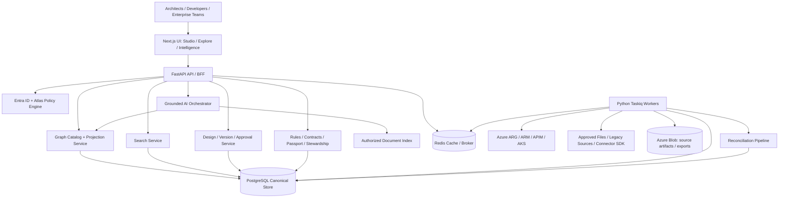
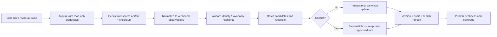
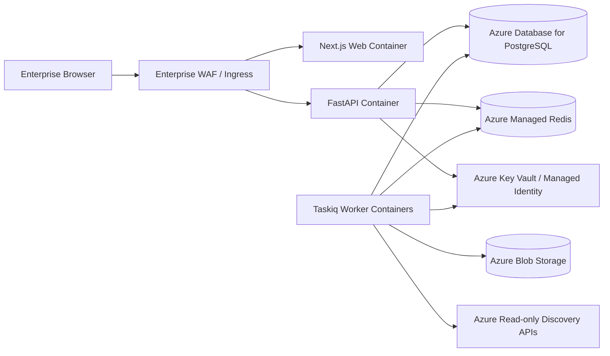

# ATLAS — Technical Architecture & System Design

**Version:** 1.1 — three-repository technical baseline  
**Date:** 24 October 2026  
**Companion documents:** `Atlas_Enterprise_Architecture_BRD_v2_2.md`, `Atlas_Bright_UX_Interaction_Requirements_v1_1.md`  
**Primary implementation language:** Python 3.12+ (pin an organization-supported patch version)  
**Status:** Architecture proposal, not an approved implementation specification

> **North star:** Atlas is a bright, polished, trustworthy architecture studio and discovery platform. Architects can design; developers can understand; enterprise teams can govern. The same canonical architecture graph powers all experiences. No PR analysis, production telemetry, distributed tracing or live monitoring.

## 0. Executive technical decisions

| Topic | Proposed decision | Why | Validation gate |
|---|---|---|---|
| Application structure | **Three independent repositories** (`atlas-backend`, `atlas-frontend`, `atlas-specs`); backend remains a modular monolith with separately scaled connector/compute workers | Independent ownership and CI/CD with a single Python domain model and contract-first integration | Cross-repository contract, deployment and worker throughput tests |
| Backend | **FastAPI + Pydantic v2 + SQLAlchemy 2 + Alembic** | Python-first, explicit schemas, async-friendly APIs, mature ecosystem | Security and coding standards review |
| Canonical persistence | **PostgreSQL 16+ managed in Azure**, with JSONB, typed entity/edge tables and relational constraints | Strong transactions, audit, flexible metadata, portability | Benchmark at 100k/1m nodes and 1m/10m edges; DB version is a proposal, not inherited from other projects |
| Traversal | SQL recursive CTE for bounded hops initially; dedicated graph projection service abstraction | Avoid premature second database and dual-write complexity | p95 traversal and graph workload tests |
| Search | PostgreSQL full-text + trigram for MVP; optional Azure AI Search/OpenSearch after benchmarks | Good developer discovery without immediate extra infrastructure | Search relevance, security filtering, p95 latency |
| Cache and queue | Redis + **Taskiq** workers; durable job records in PostgreSQL | Fits Python stack; async background ingestion, exports, reconciliation | Retry, idempotency and recovery tests |
| Frontend | **Next.js + TypeScript + React** | Rich enterprise UX, predictable component model, excellent ecosystem | Corporate browser, CSP and accessibility review |
| Diagram editor | **React Flow / XYFlow** for curated/editable subgraphs; **ELK.js** for hierarchical/orthogonal layout | Mature interactions and nested node editing; graph size managed through projections | Prototype with nested groups, 2k visible nodes and dense edges |
| Large graph exploration | Server-side projections, clustering, edge aggregation, progressive expansion; evaluate **Sigma.js/WebGL** for read-only high-density views | Separate editing ergonomics from high-density exploration | Real-browser performance, label legibility and interaction parity |
| Azure discovery | Azure Resource Graph, ARM SDK, APIM management APIs, Kubernetes API | Configuration-based discovery without telemetry | Permission, coverage and provenance mapping |
| Authentication | Microsoft Entra ID OIDC; backend validates tokens; app RBAC/ABAC | Enterprise SSO and least privilege | Security architecture and penetration test |
| Audit | Append-only application audit + database safeguards + immutable archival policy | Defensible changes and provenance | Tamper and retention tests |
| AI | Python orchestration layer with provider adapters and retrieval grounded in authorized graph/documents | Useful without inventing relationships | Golden-set grounding, RBAC and hallucination tests |
| Deployment | Azure Container Apps or AKS, depending enterprise standard | Avoid premature Kubernetes platform overhead if unnecessary | Platform standards, networking and ops review |

**Architecture decision principle:** Choose the smallest operationally sound design that can meet verified workloads. Do not select Neo4j, Kafka, microservices or a WebGL canvas merely because the total graph has thousands of entities.

## 1. Scope and non-goals

### In scope

- Atlas **Studio**, **Explore**, **Intelligence** in one bright application.
- Canonical, versioned architecture graph with C4-inspired projections, business capability mapping and Azure physical hierarchy.
- High-quality canvas, orthogonal connections, X-Ray, Passport, search, contracts, patterns, rules, data lineage, architecture history, draft branches and storytelling.
- Configuration and documentation ingestion from Azure Resource Graph, APIM, AKS, approved architecture files, supported diagram formats and enterprise metadata systems.
- Source identity resolution, reconciliation, evidence, stewardship and approval workflows.
- Permissions, auditing, export, extensible connector SDK and grounded AI assistance.

### Explicitly out of scope

- Pull request analysis, code review, PR-triggered checks or repository change-impact hooks.
- OpenTelemetry, distributed traces, application metrics, log ingestion, runtime traffic discovery, live service health dashboards or production request playback.
- Autonomous deployment/provisioning of Azure infrastructure from diagrams.
- Treating a manually drawn connector as evidence of actual connectivity.
- Building a complete CMDB/ITSM replacement.

**Clarification:** Read-only repository metadata links and approved architecture-as-code imports are permitted; they are not PR integrations. Architecture branches are Atlas model branches, not Git PRs.

## 2. Logical architecture



**Important:** Arrows indicate architectural integration, not observed traffic. Separate physical deployment diagram will be created after cloud-platform decisions.

### 2.1 Backend module boundaries

| Module | Responsibilities | Must not do |
|---|---|---|
| `identity` | Entra claims, users, groups, RBAC/ABAC decisions, scoped permission checks | Trust frontend role claims without verification |
| `catalog` | Canonical entities, aliases, typed edges, taxonomy, lifecycle | Store diagram coordinates as topology |
| `sources` | Connector definitions, observations, sync cursors, evidence | Directly overwrite approved canonical values |
| `reconciliation` | Candidate matching, conflicts, merge/split decisions, source precedence | Guess ambiguous ownership silently |
| `projections` | Scoped graph views, grouping, edge bundles, traversal, X-Ray | Return unrestricted raw enterprise graph |
| `layouts` | Personal/team/published view state, positions, routes, viewport | Alter graph facts when layout changes |
| `passports` | Component profiles, completeness, ownership, linked docs | Invent missing metadata |
| `contracts` | OpenAPI/AsyncAPI, version comparison, producer/consumer links | Infer consumers from runtime traffic |
| `patterns` | Approved templates, parameterization, sandbox instantiation | Provision cloud resources |
| `designs` | Drafts, architecture branches, diffs, merge and approvals | Confuse proposal with discovered production state |
| `rules` | Deterministic evaluation, findings, exemptions, coverage | Let LLM decide authoritative PASS/FAIL |
| `lineage` | Documented dataset flows and classification | Claim column-level lineage without source evidence |
| `knowledge` | ADRs, documents, feedback and corrections | Leak restricted content into global search |
| `search` | Unified indexed discovery, facets, authorization filters | Return unauthorized snippets or counts |
| `ai` | Grounded Q&A and draft proposals | Mutate published architecture autonomously |
| `jobs` | Task lifecycle, retries, progress, idempotency | Hide failed connector states |
| `audit` | Change history and evidence of approvals | Permit arbitrary update/delete of audit history |

**Module interfaces:** Python service interfaces and typed DTOs, not HTTP calls between modules inside the same deployment. Worker boundaries use durable jobs and versioned event payloads.

## 3. Canonical graph data model

### 3.1 Modeling layers

1. **Business:** capability, business process/journey, business domain, owner.
2. **Application:** application/system, service, logical container, component.
3. **Integration:** API, API operation, event topic/queue, file interface, integration contract.
4. **Data:** data domain, dataset, database, schema, classification, lineage transformation.
5. **Deployment:** environment, subscription, resource group, VNet, subnet, AKS cluster, namespace, workload, APIM instance, database resource, Key Vault, Service Bus.
6. **Knowledge and governance:** ADR, pattern, rule, evaluation, evidence, source, steward decision, review.

**C4 is a projection discipline, not the persistence schema.** An Azure namespace is not forced into a C4 “component” just to make a diagram work.

### 3.2 Canonical identity

- Each canonical entity gets an immutable UUIDv7 or UUIDv4; use opaque identifiers in API paths.
- Azure resources additionally retain normalized ARM resource IDs with subscription/tenant scope.
- AKS objects use cluster identity + Kubernetes UID where available; names alone are not stable identity.
- APIM APIs/operations use gateway identity + API ID/revision/operation ID as appropriate.
- Manually modeled applications use organization-controlled keys plus alias records; renames do not change canonical ID.
- A logical service and its deployments are separate entities linked by `DEPLOYED_AS`; one-to-many is supported.
- External source keys map through a `source_identity` table; never assume a shared display name proves identity.

### 3.3 Typed relationship catalog

| Type | From → To | Semantics | Evidence requirement |
|---|---|---|---|
| `CONTAINS` | parent → child | Hierarchy/ownership boundary | Source metadata or approved curation |
| `SUPPORTS_CAPABILITY` | app → capability | Business support | Business owner approval or documented source |
| `EXPOSES_API` | application → API | API provider | APIM/spec/approved documentation |
| `CONSUMES_API` | consumer → API | Declared integration | Contract/config/approved mapping |
| `PUBLISHES_TO` | producer → topic | Documented event producer | Config/AsyncAPI/curation |
| `SUBSCRIBES_TO` | consumer → topic | Documented consumer | Config/AsyncAPI/curation |
| `STORES_IN` | service → database | Documented storage dependency | Approved config/documentation |
| `DEPLOYED_AS` | logical service → workload | Logical-to-physical mapping | Deployment metadata/approved mapping |
| `CONNECTS_TO` | resource → resource | Explicitly documented infrastructure connectivity | Configuration evidence and scope |
| `OWNS` | team → entity | Stewardship | Approved owner directory/manual attestation |
| `PRODUCES_DATA` / `CONSUMES_DATA` | app → dataset | Dataset lineage | Data contract/approved mapping |
| `DECIDED_BY` | entity/edge → ADR | Design rationale | Approved linked ADR |

**Direction is never inferred from canvas geometry.** Relationship validity is enforced against versioned taxonomy rules. Cross-environment relationships must carry explicit environment scope.

### 3.4 Source observation vs canonical fact

Three distinct layers prevent corruption:

- **Observation:** “APIM connector saw API X at time T, with fields F.” Immutable/source-versioned.
- **Canonical entity/relationship:** Atlas-approved merged identity and currently selected values, each linked to provenance.
- **Presentation:** Node positions, collapsed state, edge waypoints, labels, lens and viewport. No factual authority.

Trust states: `discovered`, `documented`, `curated`, `inferred`, `proposed`, `stale`, `conflicted`. These are orthogonal to lifecycle (`active`, `deprecated`, `retired`) and environment (`prod`, `uat`, etc.). A source can be authoritative for an Azure resource ID but not for a business owner.

### 3.5 PostgreSQL table design (illustrative)

| Table | Core fields / indexes |
|---|---|
| `entity_type` | `type_key`, `schema_version`, `parent_rules`, `required_fields` |
| `entity` | `id UUID PK`, `type_key`, `display_name`, `org_key`, `lifecycle`, `classification`, `created_at`, `revision`, `metadata JSONB`; indexes on type, org_key, JSONB as justified |
| `entity_alias` | `entity_id`, `alias`, `scope`, unique scoped alias |
| `relationship` | `id UUID PK`, `from_id`, `to_id`, `rel_type`, `environment_id`, `status`, `revision`, `metadata JSONB`; indexes `(from_id, rel_type)`, `(to_id, rel_type)`, env |
| `source_system` | connector type, tenant/scope, authority policy, last successful sync |
| `source_observation` | source ID, external key, snapshot/revision, payload hash, raw artifact URI, observed_at, normalized JSONB |
| `source_identity` | `(source_id, external_key)` unique, `entity_id`, match method, confidence |
| `fact_provenance` | entity/edge ID, field path, observation ID, policy, attested_at |
| `reconciliation_case` | candidate entities, conflicting fields, evidence, steward, status, resolution |
| `graph_snapshot` | immutable snapshot ID, version, created_by, source cutoff, graph hash |
| `architecture_branch` | ID, baseline snapshot, author, state, current revision |
| `branch_change` | branch ID, sequence, entity/edge patch, validation status |
| `view_definition` | ID, owner, scope, graph selector, lens, filters, publication status |
| `view_layout` | view ID, graph revision, positions, groups, waypoints, viewport, revision; normalized storage if large |
| `contract` / `contract_version` | owner, type, source artifact, status, schema hash, effective date |
| `pattern` / `pattern_version` | schema, parameters, constraints, approval, version |
| `rule_definition` / `rule_evaluation` / `rule_finding` | versioned deterministic rule, graph snapshot, result, evidence |
| `document` / `decision` / `dataset` | canonical links, source permissions, status |
| `feedback_request` / `review` / `exception` | actor, target ID, proposed changes, approver, audit |
| `job` / `job_attempt` | durable job status, idempotency key, retry, progress, error |
| `audit_event` | append-only actor, action, target, before/after hashes, correlation ID, timestamp |

#### Example DDL — canonical core

```sql
CREATE TABLE entity (
  id uuid PRIMARY KEY,
  type_key text NOT NULL,
  display_name text NOT NULL,
  org_key text,
  lifecycle text NOT NULL DEFAULT 'active',
  classification text NOT NULL DEFAULT 'internal',
  revision bigint NOT NULL DEFAULT 1,
  metadata jsonb NOT NULL DEFAULT '{}'::jsonb,
  created_at timestamptz NOT NULL DEFAULT now(),
  updated_at timestamptz NOT NULL DEFAULT now()
);
CREATE INDEX entity_type_idx ON entity (type_key);
CREATE INDEX entity_name_idx ON entity (lower(display_name));
CREATE TABLE relationship (
  id uuid PRIMARY KEY,
  from_id uuid NOT NULL REFERENCES entity(id),
  to_id uuid NOT NULL REFERENCES entity(id),
  rel_type text NOT NULL,
  environment_id uuid REFERENCES entity(id),
  status text NOT NULL DEFAULT 'documented',
  revision bigint NOT NULL DEFAULT 1,
  metadata jsonb NOT NULL DEFAULT '{}'::jsonb,
  CHECK (from_id <> to_id OR rel_type IN ('REFERENCES_SELF'))
);
CREATE INDEX rel_from_idx ON relationship (from_id, rel_type);
CREATE INDEX rel_to_idx ON relationship (to_id, rel_type);
```

**Production hardening:** Enforce taxonomy/relationship validity in transactional service layer plus database constraints where practical; add partitioning for source observations/audit after measuring growth; apply RLS selectively where maintainable, never as a substitute for application authorization. Implement snapshot consistency through MVCC/revision manifests rather than copying the entire graph on every small edit.

## 4. Graph query, projection and performance architecture

### 4.1 Never send the entire enterprise graph to the browser

1. Client requests view with `scope`, `lens`, `environment`, `depth`, `filters`, `budget` and `snapshot`.
2. Backend authorizes scope **before** traversal and aggregation.
3. Projection service selects canonical entities, applies relationship rules and computes groups.
4. Backend returns bounded nodes/edges plus `hidden_count`, `bundle_count`, `truncated`, `continuation` and evidence summaries.
5. Client renders selected projection, asks for child groups on expand, and retains viewport anchor.
6. Detailed relationship inspection fetches individual canonical edges on demand.

**Do not reveal restricted counts** when counts themselves disclose sensitive architecture. Group totals are access-aware.

### 4.2 Query patterns

- `get_entity(id)`, `get_passport(id, env)`, `get_children(id, cursor)`, `get_neighbors(id, direction, types, depth, limit)`.
- `get_projection(view_id, lens, scope, environment, budget)` and `expand_group(projection_token, group_id)`.
- `get_shortest_documented_paths(source, target, allowed_types, max_hops, max_paths)` with explicit limits.
- `get_capability_support(capability_id)` and `get_lineage(dataset_id, direction, depth)`.
- `compare_snapshots(a, b)` and `compare_branches(a, b)`.

Bound `depth` (e.g. max 4 by default), `max_paths`, wall-clock timeout, returned edges and aggregate budget. A truncated response must explicitly say it is partial.

### 4.3 When to introduce a graph database

**Do not commit initially.** Evaluate a dedicated graph engine if representative workloads show bounded PostgreSQL traversal is insufficient, particularly high-fanout multi-hop queries, complex path constraints or graph analytics. If adopted, PostgreSQL remains authoritative; graph engine is a rebuildable, version-tagged read projection. Never perform uncontrolled dual writes.

### 4.4 Suggested performance test sizes

| Dataset | Entities | Relationships | Purpose |
|---|---:|---:|---|
| Seeded UX | 250 | 700 | Visual and E2E quality |
| Pilot | 10,000 | 40,000 | Realistic navigation, search and X-Ray |
| Scale A | 100,000 | 500,000 | Indexing, pagination, aggregation, reconciliation |
| Scale B | 1,000,000 | 10,000,000 | Long-term architectural capacity benchmark, not day-one commitment |

Test skewed graphs: APIM hubs with 5,000 consumers, dense messaging topics, deep AKS hierarchies, cycles and mixed environment scopes. A 10k-node enterprise should not imply 10k simultaneous DOM nodes.

## 5. Bright frontend architecture

### 5.1 Technology composition

- Next.js App Router, React, TypeScript strict mode, Tailwind CSS, shadcn/ui or an enterprise-approved accessible component kit.
- TanStack Query for server state; Zustand or equivalent for transient canvas interaction state; avoid duplicating canonical server records in global mutable stores.
- XYFlow/React Flow for editable diagrams and curated projections; ELK.js worker for hierarchical/orthogonal layout, with user-adjustable waypoints.
- SVG Azure icon registry with asset version, fallback and license review; icons are components/assets, not externally executed markup.
- Consider WebGL renderer only for read-only exploration at verified density; ensure equivalent selection/inspector semantics.
- CSP-compatible rendering; no arbitrary HTML/JS from imported architecture files.

### 5.2 Three integrated experiences

| Experience | Main screens | Interaction priorities |
|---|---|---|
| **Studio** | Draft canvas, palette, inspector, patterns, branch diff, import preview, storytelling | Drag/drop, nested groups, orthogonal routes, undo/redo, save/reload, approvals |
| **Explore** | Search, landscape, X-Ray, Passport, contracts, lineage, ADRs, personal workspace | Instant navigation, focused dependencies, breadcrumbs, keyboard, trust labels |
| **Intelligence** | Capability maps, reconciliation inbox, rule findings, source coverage, quality | Evidence comparison, approval, deterministic findings, clear unknowns |

### 5.3 Visual design tokens (proposed)

| Token | Value | Usage |
|---|---|---|
| `--surface-app` | `#FFFFFF` | Bright chrome |
| `--surface-canvas` | `#F8FAFE` | Architecture drawing field |
| `--surface-subtle` | `#F0F5FC` | Panels and grouped sections |
| `--ink-primary` | `#15283F` | Text |
| `--brand-primary` | `#1769E0` | Active actions, focus |
| `--entity-application` | `#5A54D6` | Application identity |
| `--entity-api` | `#1674E8` | APIs |
| `--entity-data` | `#087F8C` | Databases and data |
| `--entity-messaging` | `#C47B13` | Messaging |
| `--entity-security` | `#BD4D76` | Security identity |
| `--entity-capability` | `#22865E` | Business capability |

These are candidate colors. Validate contrast (WCAG 2.2 AA for UI), text-on-tint, color-blind distinguishability, print and official Azure icon rendering. Color alone must not encode status.

### 5.4 Canvas renderer contract

```ts
export type AtlasNode = {
  id: string; canonicalId: string; kind: string;
  label: string; parentId?: string;
  status: 'discovered'|'documented'|'curated'|'inferred'|'proposed'|'stale'|'conflicted';
  position: { x: number; y: number };
  size?: { width: number; height: number };
  collapsed?: boolean; hiddenChildCount?: number;
  iconKey?: string; selected?: boolean;
};
export type AtlasEdge = {
  id: string; relationshipIds: string[];
  source: string; target: string; type: string;
  direction: 'directed'|'bidirectional'; bundledCount?: number;
  waypoints?: {x:number;y:number}[];
};
export type AtlasProjection = {
  snapshotId: string; viewId: string; projectionToken: string;
  nodes: AtlasNode[]; edges: AtlasEdge[];
  truncated: boolean; authorizedVisibleCount: number;
};
```

**Client state separation:** `graphProjection` (read-only server response), `draftPatch` (explicit edit actions), `viewState` (filters, viewport, expansion, selection), `uiState` (panels, menus). Do not mutate a canonical graph object merely to animate a collapse.

### 5.5 Interaction architecture

- Read-only Explore is default. Entering Edit requires authorized draft context.
- Node click → selection + inspector; double-click → X-Ray; edge click → relationship inspector and contract.
- Drag canvas → pan in Explore; node drag only in Edit; keyboard alternatives for every essential action.
- Explicit semantic expansion; zooming the wheel must not automatically materialize 2,000 children.
- ELK layout runs in worker or background compute path for bounded projections. Layout results are suggestions; users can override and persist.
- Undo/redo uses typed draft commands with reversible patches. Published approvals are not undoable canvas commands.
- Every save uses optimistic concurrency (`If-Match` / revision), displays pending/success/conflict and never falsely reports success.
- Inspector is resizable/collapsible; viewport should remain stable when panel opens.
- Export SVG/PDF/PNG from controlled rendering pipeline, honoring classifications and permissions; vector-first for icons/lines.

### 5.6 Visual quality acceptance

**Must-pass:** White/light premium shell; official Azure icons; visible nesting; tidy orthogonal connections; readable labels; restrained vivid color; contextual inspector; functional toolbar; no empty gray screen; no dead buttons; browser screenshot regression at 1440×900 and 1280×720. Validate at least one realistic 100-node and one dense 1,000-node projection.

## 6. API design

**Base:** `/api/v1`; JSON, OpenAPI generated from FastAPI; cursor pagination, scoped filters, stable IDs and typed error envelopes. Version public DTOs independently from database models.

### 6.1 API surface

| Method / path | Purpose | Required safeguards |
|---|---|---|
| `GET /search?q=...` | Authorized multi-entity search | Filter before ranking and facets |
| `GET /entities/{id}` | Canonical entity summary | Entity/field access checks |
| `GET /entities/{id}/passport` | Passport sections | Environment scope, provenance, redaction |
| `GET /entities/{id}/relationships` | Direct edges | Cursor, direction, type and depth limit |
| `GET /views/{id}/projection` | Bounded landscape graph | Snapshot, budget, scope, access-aware aggregates |
| `POST /views/{id}/expand` | Expand X-Ray group | Signed/short-lived projection token, budget |
| `PUT /views/{id}/layout` | Save view presentation state | `If-Match`, layout edit permission |
| `POST /branches` | Create architecture draft | Baseline snapshot and role check |
| `PATCH /branches/{id}` | Apply typed draft commands | Idempotency key, revision precondition |
| `POST /branches/{id}/validate` | Validate schema/rules | Deterministic snapshot and rule versions |
| `POST /branches/{id}/submit` | Request review | Separation of duties |
| `POST /branches/{id}/approve` | Approve proposed design | Approver permission, audit |
| `GET /contracts` | Contract registry search | Field classification filtering |
| `GET /contracts/{id}/diff` | Compare spec revisions | Deterministic schema diff |
| `POST /imports/preview` | Stage declarative/diagram import | Malware/size/type checks, no canonical write |
| `POST /imports/{id}/commit` | Commit approved draft import | Steward decision and revision |
| `GET /reconciliation/cases` | Steward conflict inbox | Scoped roles and source evidence |
| `POST /reconciliation/cases/{id}/resolve` | Merge/split/defer | Transactional decision, audit, replay-safe |
| `POST /rules/evaluations` | Run documented architecture rules | Job ID, rule snapshot, permissions |
| `GET /capabilities/{id}/map` | Business capability projection | Scoped business and technology entities |
| `GET /lineage/{dataset_id}` | Documented lineage | Bounded traversal and classification |
| `POST /feedback` | Propose correction | Audit, ownership workflow |
| `POST /ai/query` | Grounded architecture Q&A | Graph/document permission filters, citations |
| `GET /jobs/{id}` | Job progress and errors | Owner/scope check |

### 6.2 Example bounded projection request

```http
GET /api/v1/views/enterprise-prod/projection?lens=integration&scope=claims&environment=prod&node_budget=300&edge_budget=500
Authorization: Bearer <token>
```

```json
{
  "view_id": "enterprise-prod",
  "snapshot_id": "snap_20261024_001",
  "nodes": [{"id":"grp-claims","canonical_id":"cap-claims","type":"capability","label":"Claims","hidden_child_count":43}],
  "edges": [{"id":"bundle-1","source":"grp-claims","target":"grp-policy","relationship_count":12,"types":["CONSUMES_API"]}],
  "truncated": false,
  "next_cursor": null,
  "projection_token": "opaque-signed-token"
}
```

The example is illustrative; real canonical IDs should use opaque UUIDs and a versioned response schema. **`node_budget` and `edge_budget` are capped server-side** regardless of client parameters.

### 6.3 Error contract

```json
{
  "error": {
    "code": "REVISION_CONFLICT",
    "message": "This architecture draft changed since you opened it.",
    "correlation_id": "req_...",
    "details": {"expected_revision": 12, "current_revision": 13},
    "recoverable": true
  }
}
```

Use 401 for unauthenticated, 403 for forbidden, 404 for missing/hidden resource when anti-enumeration policy applies, 409/412 for concurrency conflicts, 422 for validation, 429 for quota and 503 for temporary dependency failures. Avoid exposing connector credentials, SQL, internal hostnames or restricted identifiers in errors.

## 7. Azure and external discovery pipeline

### 7.1 Source connectors

| Connector | Source of truth for | Initial implementation | Caveat |
|---|---|---|---|
| Azure Resource Graph | Azure resource inventory, type, subscription, RG, tags | Python Azure SDK + paginated ARG queries | ARG does not prove application dependencies |
| ARM resource APIs | Selected resource configuration and relationships | Azure SDK read-only credentials | Rate limits and API version differences |
| APIM management | APIs, operations, products, backends, policies, named values metadata | Management API; redact secrets | API registration does not prove actual consumer use |
| AKS Kubernetes API | Clusters, namespaces, deployments, services, ingress and selected workload config | Kubernetes Python client with read-only RBAC | Pod ephemerality; workload identity must be normalized |
| Entra/approved directory | Team/owner reference, if permitted | Graph/directory connector | Identity/PII minimization |
| Approved OpenAPI/AsyncAPI | API/event schema and declared interfaces | Python parsers + schema validation | Consumer mapping may remain curated |
| Architecture YAML/JSON | Proposed/curated logical architecture | Schema-based staged import | Not a deployed source of truth |
| draw.io / Visio interchange | Legacy diagram presentation and candidate entities | File parser + mapping review | Shapes/lines are not verified graph facts |
| Legacy CMDB / inventory | Business ownership and non-Azure application inventory | Connector SDK adapter | Reconcile with Azure and steward overrides |

**Do not use Azure Monitor, App Insights, Log Analytics, OTel or packet inspection to discover runtime edges.** A configured APIM backend or AKS service reference can be represented as a configuration-backed relationship with evidence and limits.

### 7.2 Ingestion state machine



**Sync is idempotent:** Each connector run has `source_id`, `scope`, `cursor`, `snapshot_id`, `schema_version`, `payload_hash`, `started_at`, `completed_at`. Store source observations before reconciliation; do not delete graph objects because a single sync fails. Mark unseen resources stale according to an explicit per-source grace policy.

### 7.3 Reconciliation algorithm

1. Match immutable provider identity (normalized ARM ID, Kubernetes UID + cluster, APIM scoped ID).
2. Match previously approved `source_identity` aliases.
3. Match approved organization-controlled keys within tenant/domain scope.
4. Generate **candidate** fuzzy matches only for steward review; never auto-merge solely by name.
5. Apply per-field authority policy (e.g., Azure authoritative for ARM resource type, architecture owner authoritative for business purpose).
6. If field sources conflict at same precedence, preserve prior approved value and create case.
7. Write canonical updates, provenance and audit atomically; enqueue projection/search refresh.
8. Provide reversible merge/split with source observation history intact.

**Example:** ARG discovers an APIM instance, APIM connector discovers its APIs, and manual architecture documentation lists an API owner. The instance maps via ARM ID, API via APIM scoped identity, and owner via approved steward attestation. The three sources remain separately traceable.

### 7.4 Connector SDK Python interface

```python
from dataclasses import dataclass
from typing import AsyncIterator, Protocol

@dataclass(frozen=True)
class SourceObservation:
    external_key: str
    entity_type: str
    attributes: dict[str, object]
    evidence_uri: str | None
    content_hash: str

class ArchitectureConnector(Protocol):
    connector_type: str
    schema_version: str

    async def validate_config(self) -> None: ...
    async def discover(self, cursor: str | None) -> AsyncIterator[SourceObservation]: ...
    async def checkpoint(self) -> str | None: ...
```

Production contract also includes relationship observations, secret references, cancellation, source scope, retry classification, heartbeat, metrics **for connector job operations only** (not production application telemetry), and package version validation.

## 8. Jobs and asynchronous processing

Use Taskiq + Redis for dispatch, PostgreSQL for durable job state and idempotency. Work classes:

- Connector synchronization and normalization.
- Reconciliation batch generation and search reindexing.
- Layout computation for larger scoped diagrams.
- Architecture rule evaluations and schema diffs.
- Export generation, diagram import and PDF rendering.
- AI draft generation with explicit review.

**Worker reliability:** At-least-once delivery assumed. Handlers must be idempotent and transactionally commit canonical changes. Record `job_id`, `attempt`, `idempotency_key`, `status`, `progress`, `last_error`, `checkpoint`, `actor`, `scope`. Retry transient errors with exponential backoff and jitter; send exhausted jobs to reviewable failure state. Redis loss must not erase committed canonical facts or job history. Use outbox table for reliable post-commit indexing/notifications.

**Concurrency:** Partition sync by tenant/source/scope, use advisory locks or unique active-run constraints, and prevent overlapping destructive reconciliation. Rate-limit external Azure APIs and expose connector coverage/freshness.

## 9. Authorization, security and governance

### 9.1 Authentication and roles

- Entra ID OIDC; frontend receives appropriate tokens, backend validates issuer, audience, signature, expiry and tenant policy.
- Map enterprise groups to Atlas roles: Reader, Contributor, Architect, Steward, Reviewer, Security Reviewer, Source Admin, Platform Admin.
- Use role **plus object scope**: business domain, application, environment, classification, source and action.
- Do not assume a global Reader can view restricted architecture, security metadata, data lineage or contract fields.

### 9.2 Policy matrix (initial proposal)

| Action | Reader | Contributor | Architect | Steward | Reviewer | Source Admin |
|---|---|---|---|---|---|---|
| Search/view authorized Passport | Yes | Yes | Yes | Yes | Yes | Yes |
| Create personal view | Yes | Yes | Yes | Yes | Yes | Yes |
| Create/edit draft architecture | No | Scoped | Yes | Scoped | No | No |
| Publish architecture | No | No | Submit | Scoped | Approve | No |
| Resolve identity conflict | No | Propose | Propose | Yes | Review | Source scope |
| Edit contract ownership | No | Propose | Propose | Yes | Review | No |
| Configure connectors | No | No | No | No | No | Yes |
| Approve rule exception | No | No | No | No | Scoped | No |

All cells are subject to ABAC classification/environment restrictions and separation of duties. Final role matrix requires security approval.

### 9.3 Mandatory controls

- Access filter **before** graph traversal, search facets, bundling, AI retrieval, exports and notification generation.
- Treat architecture imports, API specs, diagram XML, connector payloads and documents as untrusted; protect against XXE, SSRF, zip bombs, path traversal, XSS and malicious SVG.
- File upload size/type limits, malware scanning, staged parsing, no arbitrary Python/JS execution from patterns or rules.
- Strict CSP, CSRF protection for cookie-authenticated flows, origin checks, secure headers, rate limits, bounded queries.
- Azure Key Vault for connector secrets; managed identities where supported; no raw secrets in graph, prompts, audit or export.
- Encrypt at rest and in transit; segregate tenants and restricted domains if required.
- Audit all authoritative graph edits, approvals, reconciliation decisions, exceptions, source configuration and sensitive exports.
- Security review of AI prompt injection: retrieved documents are data, not instructions; tool actions use explicit permission checks and human approval.
- Backups, restore drills, retention and deletion policy must be agreed with enterprise governance.

## 10. Architecture versions, drafts and approval semantics

**Published baseline** is an immutable, version-addressable logical state; **draft branch** contains changes against a baseline; **personal view** contains presentation state; **source observation** contains discovered evidence. These are distinct.

```text
Published graph rev 120
  ├─ Draft A (proposed APIM gateway)
  ├─ Draft B (event-driven alternative)
  └─ Personal view (collapsed domains, custom layout)
```

- Create branch from pinned baseline revision.
- Apply typed commands: add entity, update metadata, add/remove edge, move boundary, change layout. Graph fact changes and layout changes are separate.
- Diff branches with categories: added/removed/changed entity, relationship, evidence and layout-only.
- Three-way merge against baseline; conflicts require explicit resolution and audit.
- Run schema validation, rule evaluation and reviewer approval before promotion.
- Promotion writes new published revision atomically; does not deploy Azure resources.
- A published design can remain **proposed architecture** relative to discovered infrastructure; never mark it deployed solely because it was approved.

## 11. Rule engine architecture

Rules are versioned, deterministic Python evaluators over **authorized, pinned graph snapshots**. Avoid arbitrary user-submitted Python execution. Start with declarative, allowlisted predicates and validated templates; add a restricted rule DSL only if needed.

```python
from enum import StrEnum
from pydantic import BaseModel

class RuleStatus(StrEnum):
    PASS = "PASS"
    FAIL = "FAIL"
    UNKNOWN = "UNKNOWN"
    NOT_APPLICABLE = "NOT_APPLICABLE"
    EXEMPT = "EXEMPT"

class RuleFinding(BaseModel):
    rule_id: str
    rule_version: str
    target_entity_id: str
    status: RuleStatus
    evidence_ids: list[str]
    explanation: str
```

Examples: production database exposure, missing owner, missing contract for declared API dependency, missing data classification, unsupported lifecycle, unapproved pattern. A rule result is `UNKNOWN` if required configuration is absent or connector lacks permission. Exemptions require scope, approver, reason, expiry and audit; they do not erase underlying findings. Identical rule version + snapshot + configuration must produce identical results.

## 12. Contract Registry, data lineage and patterns

### 12.1 Contracts

- Parse approved OpenAPI and AsyncAPI artifacts; store original file and normalized versioned representation.
- Link contract operations/topics to canonical provider/consumer identities through documented mappings.
- Compare schemas deterministically: removed operations, changed requiredness/types, enum narrowing, removed fields, incompatible event changes; label compatibility findings with rule version and limitations.
- Handle duplicates and conflicting source revisions through reconciliation.
- Enforce field-level classification for sensitive schema details.

### 12.2 Data lineage

- Start at **system and dataset level**. Dataset IDs, producer/consumer, transformation description, interface contract and evidence are required for confirmed links.
- Traverse documented paths with cycle limits, scope filters and explicit unknown gaps.
- Avoid claiming column-level or runtime data movement unless an authorized, documented source provides it. No telemetry ingestion.

### 12.3 Pattern library

- Pattern is a versioned, parameterized graph template with allowed node/edge types, required boundaries, architecture rationale, controls and owner.
- Pattern instantiation produces a sandbox branch, not deployed resources.
- Parameter validation occurs before preview; rule engine evaluates resulting proposed graph; reviewer approves promotion.
- Approved, deprecated and retired versions coexist with clear status and lineage.

## 13. AI architecture assistant

**Use cases:** “What calls Policy Administration?”, “Show documented Claims dependencies,” “Who owns this API?”, “Explain why this Service Bus exists,” “Draft an alternative private APIM + AKS architecture,” “Summarize rule findings.”

**Pipeline:** intent parse → authorization-scoped graph retrieval → document/ADR/contract retrieval → evidence pack with source IDs and freshness → model reasoning → structured answer + graph selection actions → deterministic output validation → UI citations. AI-generated proposed edits go to a draft branch and require human confirmation.

**Python stack options:** Native SDK/provider adapter with Pydantic models; LangGraph only for complex multi-step workflows (not every simple search). Gemini/Azure OpenAI/other enterprise-approved provider behind a common interface. Keep model choice configurable, with data residency and retention review.

**Guardrails:** No unsupported topology claims, no bypass of source ACLs, no hidden write actions, no claims that inferred connections are verified, prompt injection resistance, model output schema validation, token/cost quotas, redaction and audit of privileged actions. Benchmark with golden questions including deliberately missing and contradictory evidence.

## 14. Search architecture

**MVP:** PostgreSQL `tsvector` + trigram/aliases, scoped entity-type filters and curated relevance boosts. Index entity names, aliases, type, domain, owner and approved searchable document excerpts. Avoid embedding classified content in an unrestricted vector index.

**Ranking:** Exact canonical key/alias > exact name > prefix > lexical relevance > authorized metadata boost. Show type, owner, environment, trust status and source. Provide filters for business domain, type, Azure subscription, environment, classification and lifecycle.

**Scale path:** Add dedicated search engine only if pilot benchmarks justify it. Reindex asynchronously via outbox; document eventual consistency. Search snippets, facets and counts are permission-filtered.

## 15. Observability of Atlas itself — not enterprise telemetry ingestion

**Allowed operational diagnostics:** Atlas API request rates/latency, worker job status, connector synchronization logs, error counts, audit correlation IDs, database health and export failures. These are operational diagnostics for **Atlas as an application**.

**Not allowed product features:** Ingesting monitored enterprise applications' traces, metrics, logs, traffic, live latency, production incident signals or live dependency playback. Keep those connectors absent from the architecture product scope.

Use structured JSON logs with correlation IDs, redaction and appropriate retention. Do not log access tokens, imported secrets or sensitive architecture content. Dashboard access restricted to Atlas operators.

## 16. Deployment architecture

### 16.1 Azure deployment option A — recommended pilot



Host on Azure Container Apps when supported by internal standards, or AKS if mandatory. Use private networking, managed identity, workload isolation, approved ingress and CI/CD. Split workers by connector/export/rules workload when necessary; they share versioned Python packages, not a giant mutable runtime.

### 16.2 Environments

- `local`: FastAPI, Next.js, PostgreSQL, Redis; mock Azure connector fixtures and realistic seeded graph.
- `dev`: integration tests with synthetic tenant/source fixtures.
- `test`: contract tests, pen-test environment, migration rehearsals and load tests.
- `uat`: selected read-only Azure sources and enterprise identity.
- `prod`: approved subscriptions/scopes with read-only discovery and controlled stewardship.

**Do not bake tenant IDs, Azure secrets, connector scopes or approval roles into source code.** All external calls go through network-approved egress.

## 17. Repository architecture and developer workflow — three independent repositories

**Decision ADR-REPO-001 (proposed):** Atlas is organized as **three separately versioned Git repositories**, not a monorepo and not merely three folders under one repository. The backend and frontend build and deploy independently. `atlas-specs` is the authoritative, versioned home for cross-team API/schema contracts, requirements and architecture decisions. **Repository boundaries do not imply microservices:** the Python backend remains a modular monolith with separate worker processes from the same backend source.

### 17.1 Repository A — `atlas-backend` (Python)

```text
atlas-backend/
├── README.md
├── pyproject.toml                    # pinned Python dependencies and tool configuration
├── uv.lock                           # if uv is selected; otherwise equivalent lock
├── .env.example                      # placeholders only, never credentials
├── src/
│   └── atlas/
│       ├── __init__.py
│       ├── main.py                    # FastAPI app composition
│       ├── api/
│       │   ├── routers/              # graph, passport, views, search, contracts, etc.
│       │   ├── dependencies/         # auth, request scope, session
│       │   └── schemas/              # Pydantic transport models
│       ├── core/                     # settings, identity, security, errors, audit
│       ├── domain/                   # canonical entity/edge rules, pure business logic
│       ├── modules/
│       │   ├── catalog/
│       │   ├── projections/
│       │   ├── passports/
│       │   ├── reconciliation/
│       │   ├── discovery/
│       │   ├── architecture_design/
│       │   ├── contracts/
│       │   ├── rules/
│       │   ├── search/
│       │   └── intelligence/
│       ├── connectors/               # Azure ARG/ARM/APIM/AKS and approved adapters
│       ├── workers/                  # Taskiq tasks, retries, job orchestration
│       └── persistence/              # SQLAlchemy, repositories, outbox
├── alembic/                          # migrations
├── tests/
│   ├── unit/
│   ├── integration/
│   ├── contract/
│   ├── security/
│   └── performance/
├── fixtures/                         # synthetic graph and connector samples
├── scripts/                          # seed, reconcile, benchmark, export
├── deploy/                           # backend and worker deployment definitions
└── .github/workflows/                # backend CI, publish, deploy
```

**Boundary:** Only backend services and workers can directly access PostgreSQL, Redis and source connectors. Frontend never connects to PostgreSQL or invokes Azure management APIs with privileged credentials. Workers and API processes may be independently scaled/deployed, but both are built from the same pinned backend commit/image family and compatible migrations.

### 17.2 Repository B — `atlas-frontend` (Next.js / React)

```text
atlas-frontend/
├── README.md
├── package.json
├── pnpm-lock.yaml                     # if pnpm is selected
├── next.config.ts
├── public/
│   └── azure-icons/                  # versioned approved icon assets
├── src/
│   ├── app/                          # Next.js routes, shell and layouts
│   ├── components/
│   │   ├── ui/                       # shadcn/ui primitives
│   │   ├── canvas/                   # XYFlow, ELK, grouping, edges, minimap
│   │   └── shell/                    # search, navigation, panels
│   ├── features/
│   │   ├── studio/                    # editor, patterns, draft branches
│   │   ├── explore/                   # landscape, X-Ray, Passport, search
│   │   └── intelligence/              # capabilities, rules, lineage
│   ├── generated/
│   │   └── api/                       # generated typed client; never hand-edit
│   ├── lib/                           # auth, API transport, state, errors
│   └── styles/                        # bright design tokens
├── tests/                             # unit and component tests
├── e2e/                               # Playwright user journeys
├── deploy/                            # frontend-only deployment definitions
└── .github/workflows/                 # frontend CI, publish, deploy
```

**Boundary:** Frontend owns presentation, canvas interactions and client state. The backend owns identity, authorization, canonical graph rules, reconciliation, validation and persistence. Never duplicate authoritative graph business rules in TypeScript. The frontend may validate forms for UX, but the backend must revalidate every write.

### 17.3 Repository C — `atlas-specs` (contracts and decisions)

```text
atlas-specs/
├── README.md
├── brd/
│   └── Atlas_Enterprise_Architecture_BRD_v2_2.md
├── ux/
│   └── Atlas_Bright_UX_Interaction_Requirements_v1_1.md
├── technical/
│   └── Atlas_Technical_Architecture_System_Design_v1_1.md
├── adr/
│   ├── ADR-0001-canonical-identity.md
│   ├── ADR-0002-graph-and-layout-separation.md
│   ├── ADR-0003-source-precedence.md
│   ├── ADR-0004-projection-and-scale.md
│   ├── ADR-0005-auth-and-authorization.md
│   └── ADR-0006-three-repository-contract-governance.md
├── contracts/
│   ├── openapi/atlas-api.yaml         # authoritative reviewed API contract
│   ├── jsonschema/                   # graph, import/export, connector payloads
│   ├── examples/                      # valid/invalid payload fixtures
│   └── compatibility.md              # versioning and change policy
├── acceptance/
│   ├── journeys/                      # Given/When/Then cross-app scenarios
│   └── golden-datasets/               # small, sanitized, deterministic fixtures
├── design/
│   └── tokens.md                      # bright UI tokens and accessibility rules
└── .github/workflows/                 # schema lint, compatibility, docs checks
```

**Boundary:** `atlas-specs` stores specifications and portable test fixtures, **not** executable backend source, frontend UI code, secrets, runtime data, or generated build artifacts. Contract changes are reviewed independently of code implementation. The design document here is the authoritative current version; old versions may be retained in a history folder.

### 17.4 Contract-first workflow across repositories

1. **Propose contract change in `atlas-specs`:** Update OpenAPI or JSON Schema, sample payloads, validation fixtures and any affected acceptance journey. Review breaking-change classification.
2. **Pin an immutable contract revision:** Each backend and frontend repository records the exact `atlas-specs` Git commit SHA or immutable release artifact version in a machine-readable `specs.lock` file. Do not track `main` for release builds.
3. **Backend implements contract:** Pydantic models and FastAPI routes must conform to the pinned OpenAPI/JSON Schema. Run request/response contract tests and negative permission tests.
4. **Frontend generates client:** Generate typed TypeScript API client from the *same pinned* OpenAPI artifact. Generated code is committed or reproducibly generated in CI; prohibit manual edits.
5. **CI checks compatibility:** Backend CI validates emitted OpenAPI against pinned contract; frontend CI validates client generation and compiles against pinned contract; cross-repo integration tests run against a deployed or ephemeral compatible backend.
6. **Promote deliberately:** For backward-compatible additions, deploy backend first, then frontend. For breaking changes, provide parallel API versions or an explicit coordinated migration; never deploy incompatible frontend/backend independently.
7. **Record provenance:** Each build reports `frontend_sha`, `backend_sha`, `specs_sha`, API contract version and DB migration revision, exposed through an authenticated diagnostics endpoint or deployment metadata.

**Recommended `specs.lock` shape** (illustrative):

```yaml
specs_repo: atlas-specs
specs_commit: "<40-character-approved-commit-sha>"
api_contract: contracts/openapi/atlas-api.yaml
contract_version: "1.0.0"
```

No floating branches, automatic unreviewed contract upgrades or runtime fetching from a mutable Git branch.

### 17.5 Independent CI/CD and release ownership

| Repository | CI responsibilities | Deployment / release output | Release gate |
|---|---|---|---|
| `atlas-specs` | Markdown/link lint, OpenAPI/JSON Schema validation, compatibility checks, golden fixtures, requirement-ID uniqueness | Immutable tagged contract artifact and approved docs | Breaking changes identified; examples valid; sign-off recorded |
| `atlas-backend` | Ruff, strict typing, pytest, migrations, contract conformance, auth/RBAC tests, dependency/SAST scan, worker tests | Versioned FastAPI image and worker image built from same source revision | Compatible `specs.lock`, DB migration safety, security and integration checks |
| `atlas-frontend` | TypeScript strict, ESLint, unit tests, generated-client reproducibility, Playwright E2E, visual regression, accessibility tests | Versioned Next.js build/image | Compatible `specs.lock`, real-browser journeys and approved bright UX baseline |

**Environments:** Each repo has its own build pipeline and deploy permissions. A release manifest (in a controlled deployment system, or versioned deployment record) binds approved backend, worker, frontend, contract and DB revisions per environment. Infrastructure definitions may live in a platform-managed infrastructure repository if company standards require it; do not create a fourth Atlas product repo unless ownership and deployment responsibilities justify it.

**Python quality baseline:** Ruff, strict mypy or pyright policy, pytest, Hypothesis for graph invariants, Alembic migration tests, SAST, dependency scanning, contract tests and typed API schemas. Frontend: TypeScript strict, ESLint, Vitest, Playwright and visual regression.

### 17.6 Local development across independent repositories

Developers clone sibling folders on their machine; **these are independent Git repositories**:

```text
workspace/
├── atlas-specs/       # independent .git
├── atlas-backend/     # independent .git
└── atlas-frontend/    # independent .git
```

- Start local PostgreSQL and Redis using the team's approved method, then run backend migrations, FastAPI and Taskiq worker from `atlas-backend`.
- Run Next.js from `atlas-frontend`, configured to call the local FastAPI base URL via approved environment settings.
- Use synthetic fixtures from backend or the pinned, sanitized `atlas-specs` acceptance fixtures; never use real secrets or sensitive architecture exports in local demos.
- Verify `specs.lock` parity before full-stack tests. Run a smoke test: open landscape → select application → X-Ray → Passport → save a draft layout → reload.
- Use a lightweight top-level local script **outside** these repos only if desired; it must not blur Git boundaries or become an unofficial fourth source of truth.

### 17.7 Cross-repository failure modes and safeguards

| Risk | Safeguard |
|---|---|
| Frontend deployed against incompatible API | Contract pinning, backward-compatible API policy, environment release manifest, predeployment smoke test |
| Backend silently drifts from published schema | Compare FastAPI generated OpenAPI to pinned spec in CI |
| Shared DTOs copied manually and diverge | Generate frontend client; validate backend schemas against the same contract |
| Workers built from different backend revision | Publish API/worker images from one backend commit and migration-compatible release |
| Breaking DB migration interrupts old frontend | Expand/migrate/contract database rollout; preserve old API contract until clients upgraded |
| Azure icon assets change unexpectedly | Pin approved icon bundle version and visual regression tests |
| Spec changes land without implementation | Allow forward-looking draft specs, but release gates only approve compatible pinned revisions |
| Cross-repo integration ownership unclear | Define code owners, change approvers, version manifest and named release coordinator |

### 17.8 Repository decision acceptance criteria

- A developer can clone each repository independently and run its CI checks without copying code from another repository.
- Backend and frontend both identify the same immutable `atlas-specs` revision for a released feature.
- The frontend typed client is generated from the pinned API contract and does not bypass FastAPI authorization.
- Backend and workers can deploy independently of the frontend while maintaining version compatibility.
- A deliberately incompatible API change is blocked by CI or deployment checks before production.
- A full-stack browser test verifies a persisted Atlas Studio/Explore journey using all three versioned artifacts.

## 18. End-to-end delivery plan

### Phase 0 — 2–4 weeks: decisions and executable spike

**Deliver:** Initialize independent `atlas-specs`, `atlas-backend` and `atlas-frontend` repositories; establish `specs.lock` and cross-repo CI checks; approve graph taxonomy draft, identity and source precedence policy, 250-entity seeded Azure landscape, interactive bright canvas spike, nested group/orthogonal edge benchmark, FastAPI projection endpoint, Entra auth skeleton, UX review.

**Exit:** Real-browser selection, pan/zoom, X-Ray expand/collapse, Passport navigation, layout save/reload and export work; no blank or dead controls; architect/developer feedback recorded.

### Phase 1 — 6–10 weeks: lovable Explore + Studio foundation

**Deliver:** Canonical graph CRUD, read-only landscape, Passport, X-Ray, search, business capability sample, personal views, draft canvas editing, official Azure icon registry, provenance, access control, PostgreSQL schema, audit.

**Exit:** Developer finds owner and dependency; architect creates a 6-node Azure design and saves it; permission/negative tests pass.

### Phase 2 — 6–10 weeks: trustworthy discovery

**Deliver:** ARG, APIM, AKS connector pilots, durable job pipeline, observation store, deterministic reconciliation, conflict inbox, source coverage/freshness, approved correction workflow, contract registry baseline.

**Exit:** Idempotent re-sync, no duplicate canonical entities in golden fixtures, stale-source warnings and field-level evidence.

### Phase 3 — 6–10 weeks: design productivity

**Deliver:** Pattern library, architecture-as-code, draw.io import preview, draft branching/diff/merge, ADR links, presentation mode, rule engine baseline.

**Exit:** End-to-end sandbox → validation → review → promotion without cloud mutation; import does not mark lines verified.

### Phase 4 — 8–12 weeks: enterprise intelligence

**Deliver:** Documented lineage, advanced business maps, architecture history/drift, grounded AI assistant, governance reports, extensible connector SDK, scale hardening.

**Exit:** Evidence-based answers, deterministic rule evaluations, authorized data access and 100k-entity performance benchmark.

**Estimates are directional, not staffing commitments.** Parallelization depends on actual team size, source permissions, UX feedback, security review and corporate deployment readiness. Avoid promising all BRD V2.2 features in MVP.

## 19. Detailed MVP backlog — vertical slice

| Epic | User story | Backend deliverable | Frontend deliverable | Test evidence |
|---|---|---|---|---|
| E01 Canonical graph | As architect I can model applications and typed relationships | Entity/edge schema, validation, migration | Seeded enterprise landscape | Type and identity invariant tests |
| E02 Projection | As developer I can view a readable large landscape | Scope-aware projection, grouping, pagination | Bright XYFlow canvas, zoom/fit, bundles | 5k canonical graph + bounded view test |
| E03 Passport | As developer I can identify an app's owner and APIs | Passport aggregation with provenance | Owner, contracts, dependencies and evidence tabs | Owner lookup E2E |
| E04 X-Ray | As engineer I can expand an app in place | Hierarchical child projection | Nested groups, breadcrumbs, collapse | Expand → inspect → collapse E2E |
| E05 Editing | As architect I can design a future state | Draft commands, revision, layout store | Azure palette, ports, routing, undo/redo | Save/reload/412 conflict E2E |
| E06 Search | As developer I can find a system quickly | Scoped FTS/aliases | Cmd+K, result facets | Relevance and ACL tests |
| E07 Governance | As steward I can correct an owner | Feedback, approval, audit | Suggest correction and review state | Unauthorized edit blocked |
| E08 Security | As restricted user I only see permitted data | Entra token validation, ABAC, field filtering | Role-aware controls and redaction | Negative search/graph/export tests |
| E09 Quality | As product owner I can validate a real product | Seed fixtures, test endpoints, metrics | Playwright visual regression | CI gate on primary journeys |

### 19.1 Proposed first sprint sequence

1. **Sprint A:** schema/identity, synthetic graph generator, API shell, bright app shell, Azure icon registry.
2. **Sprint B:** scoped projection API, canvas selection/pan/zoom, Passport inspector, search and deep links.
3. **Sprint C:** X-Ray, edge bundles, semantic grouping, layout save/reload, responsive inspector.
4. **Sprint D:** draft editing, typed connections, ELK routing, undo/redo, browser E2E and user validation.

Do not start full connector development before canonical IDs and reconciliation semantics are reviewed.

## 20. Quality and acceptance plan

### 20.1 Functional gates

- **Architect:** create nested Azure architecture, connect APIM → AKS → Service Bus → database, reroute edges, save/reload, export, compare draft.
- **Developer:** search Claims API, open Passport, inspect documented consumers and source, expand X-Ray, return without losing context.
- **Business:** open Claims Settlement capability, trace to supporting applications and share scoped view.
- **Steward:** review conflicting owner from two sources, choose authoritative value, audit decision, rerun sync without duplication.
- **Security:** verify no restricted entity/edge/contract field leaks through graph, search, AI, URL or export.

### 20.2 Nonfunctional targets (proposed, validate with hardware)

| Measure | Initial target | Test profile |
|---|---|---|
| Search p95 | ≤1.5 seconds | Pilot dataset, warm index, corporate network |
| Passport p95 interactive | ≤2.5 seconds | 1440×900 reference corporate laptop |
| Curated landscape p95 interactive | ≤3 seconds | ≤300 rendered nodes/≤500 visible edge bundles |
| X-Ray expand p95 | ≤2 seconds | Typical application with bounded child projection |
| Graph storage | ≥100k entities/500k relationships benchmark | Read/search/update/reconciliation workload |
| Projection correctness | 100% of golden paths and authorized filters | Synthetic graph with cycles, hubs and ACLs |
| Draft persistence | No silent loss; revision conflict detected | Save/reload and concurrent edits |
| Accessibility | WCAG 2.2 AA UI; keyboard equivalent for core graph tasks | Automated + manual testing |
| Export | Accurate scope, revision, confidentiality and icons | SVG/PDF/PNG golden cases |
| Source trust | 100% imported facts have source/timestamp | Data integrity test |

Do not confuse rendering 300 visible nodes with storing only 300 nodes. Rendering budgets are UX safety controls, not graph data limits.

### 20.3 Testing pyramid

- Unit: taxonomy, identities, relationship constraints, normalization, matching, rule statuses, schema diff.
- Property-based: duplicate sync invariants, cycles, edge direction, merge/split reversibility.
- Integration: PostgreSQL transactions, Redis job recovery, blob artifacts, Azure connector fixtures.
- Contract: OpenAPI, frontend typed client, connector SDK compatibility, import schema.
- Security: authorization across graph/search/AI/export, malicious SVG/XML, injection, CSRF, SSRF, secret redaction.
- E2E: Playwright real browser, persisted backend, no mocked clicks in acceptance tests.
- Visual: golden screenshots, Azure icon fidelity, light palette, dense graph, zoom, export.
- Performance: Locust or k6 for API workload; browser performance profile for pan/zoom/layout; reconciliation throughput.
- Recovery: restore snapshot, replay outbox, retry jobs, resume connector cursor, handle source outage.

## 21. Risks and mitigation

| Risk | Impact | Mitigation |
|---|---|---|
| Graph turns into hairball | Users abandon Atlas | Scoped projections, semantic zoom, bundled edges, curated views |
| Discovery creates false relationships | Users stop trusting platform | Evidence typing, no runtime claims, steward review, unknown states |
| Duplicate entities from sources | Incorrect impact paths | Stable source IDs, deterministic reconciliation, merge/split audit |
| Frontend canvas struggles with nested dense graphs | Poor experience | Benchmark XYFlow/ELK early; split editing and high-density exploration |
| Excessive platform scope | Slow delivery | Thin vertical slice, explicit release gates, defer P2 |
| Unauthorized topology exposure | Security incident | Authorization before traversal/aggregation; negative tests |
| Import turns drawings into 'facts' | Governance failure | Staged import, mapping approval, proposed status |
| AI hallucinates ownership/dependencies | Bad decisions | Grounded citations, explicit uncertainty, deterministic tools |
| Connector rate limits and permissions | Stale/incomplete inventory | Cursors, retries, coverage dashboards, source freshness |
| Layout and graph facts mixed | Data corruption | Separate stores and revision semantics |
| Schema changes break clients | Delivery instability | Versioned DTOs, contract tests, migration strategy |
| Rules become arbitrary executable code | Security and reliability risk | Allowlisted deterministic DSL/evaluators, signed admin publication |

## 22. ADRs to resolve before build

| ADR ID | Decision needed | Current proposal | Owner |
|---|---|---|---|
| ADR-001 | Canonical store | PostgreSQL relational typed graph + JSONB | Architecture + DBA |
| ADR-002 | Diagram engine | XYFlow + ELK.js, WebGL exploration optional | Frontend lead |
| ADR-003 | Identity and reconciliation | Provider keys + source identity + steward workflow | Data/Platform lead |
| ADR-004 | Authentication | Entra ID OIDC, ABAC + RBAC | Security |
| ADR-005 | Background jobs | Taskiq + Redis + PostgreSQL durable jobs/outbox | Backend lead |
| ADR-006 | Search | PostgreSQL FTS/trigram initially | Backend lead |
| ADR-007 | Deployment | Azure Container Apps vs AKS | Cloud Platform |
| ADR-008 | Architecture snapshot strategy | MVCC/revision manifest + branch changes | Data architect |
| ADR-009 | Import security and supported Visio formats | draw.io XML first, staged Visio interchange | Security + UX |
| ADR-010 | AI provider/data boundary | Enterprise-approved provider adapter | AI + Security |
| ADR-011 | Graph scale threshold for separate graph engine | Benchmark-driven | Architecture |
| ADR-012 | Source authority by field | Explicit per-source precedence and conflicts | Enterprise Architecture |
| ADR-013 | Model-level permissions and restricted counts | Server-side ABAC and anti-enumeration | Security |
| ADR-014 | Rule DSL and exception semantics | Deterministic allowlisted evaluator | Governance |

## 23. Traceability to BRD V2.2

| Technical area | Primary BRD requirement families |
|---|---|
| Canonical graph, C4 views | INV, MOD, XRAY, BCM |
| Canvas, Studio, layouts | CAN, UX-CAN, UX-XR, BRN, STORY |
| Passport, search, developer experience | DEV, PASS, CMD, ADR, FBK |
| Contracts and lineage | DEP, ICR, LIN |
| Azure discovery and reconciliation | CON, REC, SDK |
| Patterns and design validation | PAT, RULE, AAC, IMP |
| Governance and collaboration | GOV, COL, NTF |
| AI grounded assistant | AI |
| Security, performance, usability | NFR and UX-NFR |

**Traceability work remaining:** Import all actual BRD requirement IDs into a requirements registry, link each to one or more backlog stories, API/data contracts, acceptance tests and release gates. Do not claim full traceability until that mapping is machine-checked.

## 24. Implementation readiness checklist

- [ ] Confirm MVP scope and primary personas with Enterprise Architecture and developer representatives.
- [ ] Approve graph taxonomy, canonical ID strategy and relationship type matrix.
- [ ] Approve field-level source authority and reconciliation decisions.
- [ ] Approve Entra role mapping, classification rules, source scopes and export policy.
- [ ] Run XYFlow/ELK proof of concept with realistic Azure nesting, dense connectors and browser E2E.
- [ ] Validate bright design tokens and official Azure icon set with architects and developers.
- [ ] Confirm database, Redis and Azure hosting standards with platform team.
- [ ] Establish synthetic graph fixtures and golden data-quality tests.
- [ ] Define per-phase acceptance owners and sign-off evidence.
- [ ] Explicitly check that no PR or production telemetry feature enters implementation backlog.

---

## 25. Final engineering recommendation

**Build a modular Python backend, not a distributed microservice maze.** Make the graph trustworthy first; make the canvas beautiful and interactive immediately; bring real Azure discovery in only after identity/reconciliation is sound. Preserve the user's place across every interaction. Let every architect create an excellent diagram, every developer answer a question quickly, and every reviewer inspect the evidence behind a relationship.

**Suggested first executable milestone:** A bright Atlas application showing **Digital Channels → APIM → New Business → Policy Administration → Claims**, with official Azure icons, nested AKS/APIM/Service Bus/SQL resources, real click/zoom/expand, Passport, source labels and persistent layout. This becomes the design and implementation benchmark for everything that follows.

## 26. V1.1 revision record

**Change:** Replaced the single `atlas/` repository tree with three independently versioned Git repositories (`atlas-backend`, `atlas-frontend`, `atlas-specs`). Added contract-first schema ownership, immutable contract pinning, frontend client generation, separate CI/CD, release compatibility matrix, local workspace layout, cross-repository failure safeguards and Phase 0 repository setup. The backend remains a Python modular monolith with separately deployed worker processes. Functional scope and explicit exclusions are unchanged.
